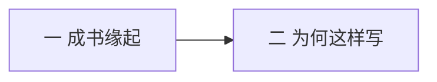

# 自序

> [!abstract] 一句话
> 这不是客套，是态度声明：书从通识课来，只写到 [[黑格尔]]，要用通俗但不戏说的方式把智慧讲清楚。

上一篇：无 · 下一篇：[[01 哲学是什么与哲学有什么用]]

## 1. 结构

分 **两大部分**，没有更细的小节标题。

| 部分 | 在讲什么 |
|------|----------|
| 一 | 武大、东南大学通识课录音如何变成这本书 |
| 二 | 范围、对现代哲学的判断、希望读者如何读 |

## 2. 第一部分：成书缘起

材料是武汉大学和东南大学通识课的录音整理，不是把专业教材再压一遍。作者从 1990 年代初就在武大开全校通识课，后来又给哲学系上专业课；2004 年和邓晓芒合著的《西方哲学史》由高等教育出版社出版，2006 年他主讲的专业课评上国家精品课程。那些专业本和课程网站对非哲学专业未必合适，所以他一直想写一部更通俗简明的讲义。东南大学国家大学生文化素质教育基地请他去讲，这个夙愿才落地。

讲课立场写得很清楚：按自己所思所想讲，不按教条圭臬讲。他承认哲学课本来枯燥，但因为掺进了自己的心灵体验，教室反而挤满，有时还得挤进门、挤上讲台。东南大学那一段他写得很动感情：理工科为主的学校，四百人教室加过道小板凳，开讲前全体起立唱校歌。他用这些场面说明一件事——通识课不是把思想降格，是换一种讲法，让同样那些概念在课堂上活起来。

> [!tip] 读法
> 后文口语、举例、情绪都来自课堂。当论证时，把它当论证；当感慨时，不必当公理。

## 3. 第二部分：写到黑格尔为止

书从古希腊讲起，沿着思想史的线索讲到 [[黑格尔]] 为止，现代西方哲学不在范围里。他给了三层理由。第一是篇幅和课程惯例：通识课讲不完，国内也常把「西方哲学史」和「现代西方哲学」拆成两门。第二是个人口味：他觉得现代哲学越来越像刻板规范的技能，不再是博大精深的智慧。第三是他的哲学史观：希腊是自由心灵的智慧；中世纪把希腊思想以扭曲的形式扭进神学；近代受实验科学影响，智慧之学变成规范化的知识体系，体系一个接一个建立起来，独创性却比不上希腊人；到了现代，哲学容易沦为技艺和文本转译，面对的不再是鲜活的宇宙和人生，而是以往哲学家对宇宙和人生的解释。

> [!example] 他用来说明「现代像考据」的两个画面
> 一个生活在两百多年前的 [[康德]]，今天可以养活成千上万个把康德哲学研究得比康德本人还清楚的「康德哲学家」。关于《精神现象学》的解读文本，已经多到足以把任何敢于研究黑格尔的人弄晕。作者的判断很重：今天的哲学家不再是对世界有独立见解的爱智者，而容易变成躺在已逝著作里引经据典、把古人智慧批发零售的精神掮客。这是讲述立场，不是定理。

[[密涅瓦的猫头鹰]] 在这里被他多推了一刀。黑格尔原意是：一种时代精神快结束时，哲学才真正理解它，黄昏才起飞。作者接着说：猫头鹰在黑格尔那里被放飞之后，继哲学的黄昏而来的就是精神的漫漫长夜。也就是说，他用这只鸟同时解释两件事——哲学是事后的反思，以及黑格尔之后哲学开始没落。后一句是他的口味。

对现代生活他还有一句更刺耳的概括：现代人太清醒了，只相信现象，看穿本质不过是人虚构的幻象；[[斯芬克斯之谜]] 已经不可能再让他们困惑，因为他们根本不需要去想那些稀奇古怪的东西。活着，并且快乐着，就是秘诀。哲学这种沉重的东西，当然就被弃之如敝屣。即便如此，他仍说有人会继续追问那些没有终极答案的问题。

他承认自己不是哲学家，充其量是传扬以往思想的教书匠。荷马吟颂英雄史诗，自己不会因此变成英雄；即使相信 [[哲学史就是哲学]]，讲哲学史的人也不等于哲学家。站在讲台上，他只是以先学者的身份带学生去仰视那些人，体验他们的哲思。「高山仰止，景行行止。虽不能至，然心向往之。」

写作原则也写在这一节里：完全用讲故事的方式来「戏说」哲学，他不赞成；把哲学讲成天书，他又觉得是故弄玄虚，不是讲述者诡谲，就是笨拙。他要尽量通俗，又保住哲学的本性和旨趣。基本信念是：每一个人都具备哲学的慧根，这慧根能否长成大树，主要靠自己的机缘和悟性；讲述古人的智慧，或许能启发读者去发扬这颗慧根。

落款：2009 年 2 月 18 日，武汉大学。

## 4. 作者眼里的四个时代

| 时代 | 哲学状态 |
|------|----------|
| 古希腊 | 生机盎然，几乎问遍人类思维能关注到的深刻问题；没有前人圭臬，观点清新通达 |
| 中世纪 | 希腊思想以扭曲形式进入神学 |
| 近代 | 智慧之学变成体系化知识，独创性不如希腊，体系却一个接一个建立起来 |
| 现代 | 容易沦为技艺和文本转译；人只求快乐地活着，不再被根本问题困扰 |

> [!warning] 先记下这个口味
> 作者更爱古典。读到他贬希腊化、文艺复兴、20 世纪时，先当「讲述者立场」，再自己判断。第一讲会把这个口味再讲一遍：放弃本质、只跟感觉走，在他看来是从人滑向动物的路。

## 5. 本篇术语

- [[密涅瓦的猫头鹰]] — 哲学是黄昏才起飞的反思；作者又用它写「黑格尔后没落」
- [[哲学史就是哲学]] — 黑格尔的命题，第一讲会展开；自序先挡一句：讲哲学史的人 ≠ 哲学家
- [[斯芬克斯之谜]] — 现代人不再被根本问题困扰

## 6. 复盘

- [x] 知道这本书为什么不写现代
- [x] 能复述作者对希腊 / 近代 / 现代的态度

> [!question]- 参考（先自己答）
> 不写现代：课时惯例 + 个人口味（现代像技能／考据）+ 哲学史观（希腊最有生机）。四时代：希腊生机 → 中世扭进神学 → 近代体系化 → 现代易成技艺。当讲述立场，见 [[易混对照]]「作者口味」。
