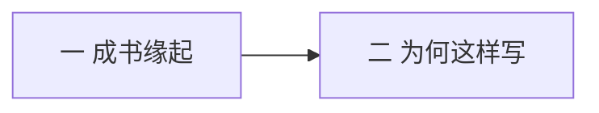

# 自序

> [!abstract] 一句话
> 这不是客套，是态度声明：书从通识课来，只写到 [[黑格尔]]，要用通俗但不戏说的方式把智慧讲清楚。

上一篇：无 · 下一篇：[[01 哲学是什么与哲学有什么用]]

## 1. 结构

分 **两大部分**，没有更细的小节标题。

| 部分 | 在讲什么 |
|------|----------|
| 一 | 武大、东南大学通识课录音如何变成这本书 |
| 二 | 范围、对现代哲学的判断、希望读者如何读 |

## 2. 第一部分：成书缘起

- 材料是讲课录音，不是按专业教材压缩出来的。
- 作者和邓晓芒合著过专业本《西方哲学史》，那本对非哲学专业不一定合适。
- 讲课立场：按自己所思所想讲，不按教条圭臬讲。

> [!tip] 读法
> 后文口语、举例、情绪都来自课堂。当论证时，把它当论证；当感慨时，不必当公理。

## 3. 第二部分：写到黑格尔为止

三层理由：

1. **篇幅和课程惯例。** 通识课讲不完；国内常把「西方哲学史」和「现代西方哲学」拆成两门。
2. **个人口味。** 作者觉得现代哲学越来越像规范技能。
3. **哲学史观。** 希腊是自由心灵的智慧；中世纪扭进神学；近代变成规范化知识体系；现代容易变成对着古人做考据。

他承认自己不是哲学家，只是带学生去仰视那些人。荷马吟英雄，自己不会变成英雄。即使相信 [[哲学史就是哲学]]，讲哲学史的人也不等于哲学家。

写作原则：不戏说成故事，也不讲成天书；尽量通俗，保住哲学味道。相信人人有慧根。

落款：2009-02-18，武汉大学。

## 4. 作者眼里的四个时代

| 时代 | 哲学状态 |
|------|----------|
| 古希腊 | 生机盎然，几乎问遍能问的深刻问题 |
| 中世纪 | 希腊思想以扭曲形式进入神学 |
| 近代 | 智慧之学变成体系化知识 |
| 现代 | 容易沦为技艺和文本转译 |

> [!warning] 先记下这个口味
> 作者更爱古典。读到他贬希腊化、文艺复兴、20 世纪时，先当「讲述者立场」，再自己判断。

## 5. 本篇术语

- [[密涅瓦的猫头鹰]] — 哲学是黄昏才起飞的反思
- [[哲学史就是哲学]] — 黑格尔的命题，第一讲会展开
- [[斯芬克斯之谜]] — 现代人不再被根本问题困扰

## 6. 复盘

- [x] 知道这本书为什么不写现代
- [x] 能复述作者对希腊 / 近代 / 现代的态度

> [!question]- 参考（先自己答）
> 不写现代：课时惯例 + 个人口味（现代像技能／考据）+ 哲学史观（希腊最有生机）。四时代：希腊生机 → 中世扭进神学 → 近代体系化 → 现代易成技艺。当讲述立场，见 [[易混对照]]「作者口味」。
