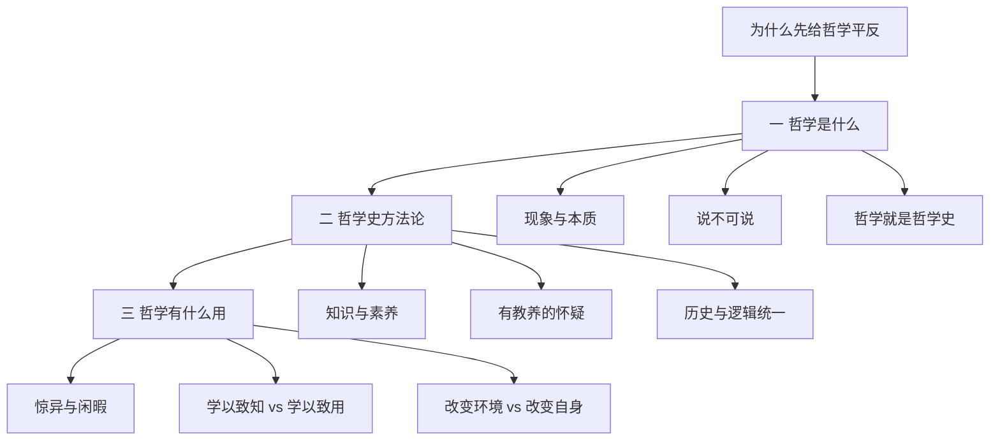

# 第一讲 哲学是什么与哲学有什么用？

> [!abstract] 一句话
> [[哲学]] 是对那些永远说不清的本质问题的追问；它不烤面包，但能改变你看世界的眼光。学它必须经过哲学史。

上一篇：[[00 自序]] · 下一篇：[[02 希腊自然哲学]]

## 1. 结构

三大节、九小节，外加开场。这一讲是方法，不是人物列传——不要给人名硬加「故事」。

---

## 2. 先给哲学平反

很多人反感哲学，多半是被教成了：句句真理、和政治绑死、经院式灌输。把教科书说成不可怀疑，本身就违背哲学精神。这一讲先恢复它作为开放智慧之学的面目。

---

## 3. 哲学是什么？

### 3.1 现象与本质

作者拒收大而空的定义（「理论化系统化的世界观和方法论」）。那种定义无所不包，等于没说。

如果必须说：

> [[哲学]] 是在永无止境的自否定中生长的怀疑精神与批判意识；是对永无定论的 [[形而上学]] 问题的执着追问。 ^def-philosophy

人和动物都看 [[现象与本质|现象]]；人还要问背后的本质。于是出现更狠的一问：本质是事物固有的，还是只是人的思维习惯？

> [!example] 猫和老鼠
> 老鼠在猫眼里就是一个活蹦乱跳的小东西，扑上去吃掉，问题就解决了。猫不会去想「老鼠的本质是什么」。人面对大千世界却总忍不住要问背后的规律。作者说，相对现象而言，人甚至更看重本质。

他不替你一锤定音。若本质是事物固有的，透过现象找本质说明人比动物高明；若本质只是思维习惯，人很可能把本来简单的问题复杂化了。日常会毫不犹豫选第一种，但从第二种想一想也有意义——也许世界本来无所谓本质，只是人的大脑被构造成喜欢把简单问题弄复杂，于是有了哲学。古典到黑格尔走 [[本质主义]]：本质唯一、不变、不生不灭，现象转瞬即逝；一代人活着、一代人死了，「人的本质」并不因为亚里士多德死了或活着而改变。20 世纪很多哲学走反本质、只看现象，觉得两千多年争物质还是精神是一场无聊。作者气质上是古典主义者：即使本质是虚构的，哲学也只能继续追问，否则就不叫哲学。这个陷阱是人必须挖的，它体现的是人的神性；哲学是一场必然的悲剧，以严肃态度对待它，反而已经超越了悲剧。

> [!warning] 他的价值判断
> 放弃本质、只跟感觉走，是哲学的低谷，也是一条从人滑向动物的路。希腊化、文艺复兴、20 世纪都被他这样看。推到极端，就是他引的那句「我是流氓我怕谁」。读第六讲时记得对照，不必全盘接受。

### 3.2 「说不可说」

一个未经哲学训练的年轻人面对世界，往往非常自信地说「事情就是这样的」——这恰恰说明他对本质一无所知。当他开始怀疑、开始觉得「事情未必是这样的」，才开始用哲学的眼光看世界。

张世英把哲学收成 [[说不可说]]：对象说不清，人还是要接着说。每位哲学家都以为自己到了巅峰，后来者又从他头顶爬过去。一部哲学史就是一部不断「接着说」的历史，话题却是那些同样古老的问题。作者把它接到《周易》「形而上者谓之道，形而下者谓之器」，以及老子「道可道，非常道」：能说清楚的就不是真正的道。西方从希腊起，真正的哲学也被称为 [[形而上学]]——不是课本里那个贬义词，见该卡。

陈修斋说 [[哲学无定论]]——不是人暂时不够聪明，是对象无法拿进实验室。牛顿三大定律在确定的时空范围内就是绝对真理，受过教育的人不论阶级、肤色、有神无神都会接受；唯物与唯心、一元与二元却永远说服不了所有人。即使再过几千年，那些基本问题仍然说不清。作者加码：无定论不是缺陷，是魅力来源。

[[知识与智慧]]：知识可背、可考；智慧是看世界的方式，常常出现在知识穷尽处。考试得 90 分甚至 100 分，不等于懂哲学。康德那句当作学习目标：==不是教你们哲学，而是教你们如何哲学地思维==。听完这门课，除了考完还给老师的那些知识，若还有一些在脑子里扎下根、改变了思维方式的东西，那些才是真正的哲学。

哲学的功能首先是改变自身，不是改造世界。世界就是你眼中的世界。离眼睛最近的东西（眼睫毛）恰恰看不见——这个道理太简单，所以我们往往看不见。

### 3.3 哲学就是哲学史

见 [[哲学史就是哲学]]。原理是凝固的；哲学是活的，只活在历史里。黑格尔把绝对精神写成一部从东方走到他自己的长剧，最后像浮士德那样说「请停留一下吧」——狂妄，但点出一件事：不走完这部史，进不了哲学。我们并不比古人更聪明（两千多年里大脑结构没有根本变化），优势只有后见之明。把马克思从西方哲学史里拔出来单独供着，会让它变成无源之水。

---

## 4. 哲学史方法论

三条，都是态度，不是操作手册。后文章节里每人先有一段故事，再讲理论，就是把这三条写成可跟的叙述。

### 4.1 知识配素养：如何把自己放回他的问题里

会背柏拉图不够。知识是汇集下来的命题；素养是：你站在他当时的死结前，问「若是我，下一步能往哪走」。智慧常出现在现成知识穷尽处。

「放回去」不是穿越演戏，是四步：

1. **先钉死结。** 他桌上已有什么答案，哪一句再也推不动。
2. **只准用当时桌上的材料。** 不要用后来的词替他做决定（别让黑格尔替赫拉克利特说话，别用量子力学打德谟克利特）。
3. **跟他走完那一步。** 看他为什么选这个出口，而不是别的出口。
4. **再找阿喀琉斯之踵。** 后见之明是用来发现弱点的，不是用来一开始就说「不」。

后面各讲，各用一句练这四步：

| 讲 | 把他放回哪一句 | 才懂什么 |
|----|----------------|----------|
| [[02 希腊自然哲学]] | 根据还要不要写成「某神生某神」 | [[泰勒斯]] 选水对不对是次要的；根据从神谱里拿出来才是第一步 |
| [[03 希腊形而上学的源端]] | 变若是真的，话还怎么说得住 | [[巴门尼德]] 为什么只留 [[存在]]，把火贬成意见 |
| [[04 希腊怀疑论与道德哲学]] | 尺度若在个人，美德还能不能教 | [[苏格拉底]] 为什么先自知其无知，而不是另卖一套智慧 |
| [[05 希腊实在论哲学]] | 感觉里的东西站不住，知识的对象在哪 | [[柏拉图]] 的 [[理念]] 不是心里的念头 |
| [[06 希腊哲学的衰颓]] | 城邦垮了，个人怎么活 | 哲学为什么从追本原变成「灵魂的救护车」 |
| [[07 中世纪基督教哲学]] | 启示已在，理性还干什么 | [[安瑟尔谟]] 的证明不是「发现」上帝，是 [[信仰寻求理解]] |
| [[08 近代哲学的转向与英国经验论]] | 一切来自经验，实体和因果经验给得出吗 | [[休谟]] 的怀疑不是抬杠，是原则推到底 |
| [[09 欧洲大陆唯理论哲学]] | 感觉不可靠，不可怀疑的起点在哪 | [[笛卡尔]] 为什么先站稳「我思」，再谈世界 |
| [[10 18世纪法国启蒙哲学]] | 理性法庭审判一切，理性自己审过没有 | [[卢梭]] 为什么是阵营黑马，通向康德 |
| [[11 康德的批判哲学]] | 科学必然性塌了，沃尔夫闭门推，启蒙不自审 | 为什么认识之前必须先审理性 |
| [[12 从费希特到黑格尔]] | [[物自体]] 必须假定又不可知 | [[费希特]] 为什么砍掉它；裂缝怎样一棒接一棒 |

读某一讲卡住时，先回到表里那一句，再往下看他怎么走。人物卡写生平与后世纪；章节用故事把人放回问题里。

### 4.2 [[有教养的怀疑]]

两种坏开端：觉得人人都对；对什么都先说「不」。怀疑是哲学素质，但必须建立在走进去之后。没懂就说「不」，是对自己说不。

对每一位：先走进去尊敬（处在他的时代，你未必有他那一刀），再凭后见之明走出来，找要害。既不简单说「是」，也不简单说「不」。

### 4.3 [[历史与逻辑相统一]]

黑格尔的说法：[[哲学史就是哲学]]。外表是人名登场，内里是同一个概念在长。抽掉名字，第二讲剩下的是质料意义上的 [[本原]]：水 → 阿派朗 → 气 → 火 → 原子。那是这条方法的第一次演习。

不是到古战场捡骨头做考古。概念发展到某一环，就会「选中」某个人来说话——不是哈姆雷特在说话，是有一个东西借哈姆雷特在说话。没有拿破仑也会有另一个人完成那件事，没有柏拉图也会有另一个人把那套思想说出来。话说得霸道，用处是：别把哲学史看成杂乱拼盘。

---

## 5. 哲学有什么用？

### 5.1 哲学从哪里来

詹姆士：[[哲学不能烤面包]]。亚里士多德给了两个条件：[[惊异与闲暇]]。惊异是问题意识，动物多半只有恐惧和警觉，很少在没有受威胁时产生惊奇。闲暇说得很朴素：吃饱了饭、没有后顾之忧，才有心思去想那些虚无缥缈的问题。希腊最早一批哲学家几乎都是自由民；奴隶要为生计操劳，顾不上这些。若要求哲学必须跟谋生、升官挂钩，在亚里士多德看来，就已经把自己放在奴隶的位置上了。学哲学没有实用目的，掌握智慧本身就是最高目的。

[[智者]] 自称有智慧的人，智慧可以卖钱。苏格拉底把他们称为「批发和零售灵魂食粮的人」。苏格拉底传统只承认自己爱智慧，把哲学当谋生术是卑劣的。希腊主流：为知识而知识。问精神快乐有什么用，就像问听贝多芬有什么用。

### 5.2 中西对照

苗力田晚年一言以蔽之：中国「重现世、尚事功，学以致用」，西方「重超越、尚思辨，[[学以致知]]」。这是文化取向的概括，不是说中国没有思辨、西方没有实用。哲学在急功近利的眼光里是「屠龙之术」——花了千金学三年，学会屠龙，没有龙给你屠。更糟的是硬派出现实用处。作者经历过那种人人谈哲学、种田炼钢都挂上哲学的热潮：表面热捧，实际把哲学抽成包治百病的狗皮膏药。狂热比冷漠更伤害哲学；一个社会里人人都大谈哲学，一定是一个疯狂的社会。

### 5.3 两种「用」

法学、经管、计算机走改变环境：知识换成金钱地位，再改善住房衣着，最后才从享受和别人的羡慕里感到快乐——绕了一大圈。哲学、音乐、诗走 [[改变自身]]：听贝多芬、读散文、做一次思辨，快乐当场发生。作者更看重后一条。一块石头对路人没有意义，对地质学家就有——不是石头变了，是主体变了。人活在自己的感受里，不是活在纯粹客观的世界里。不必接受贝克莱「存在就是被感知」，但至少：存在的意义离不开感受和思维。眼光改了，就不那么容易随波逐流，比较能体会但丁那句「走自己的路，让人们说去吧」。

他自称不是唯物者也不是唯心者，而是有教养的怀疑者。生活必有悲剧；没有经历过悲剧的人生，在他看来才是真正悲惨的。有素养就把悲剧看成插曲，甚至带一点崇高。贬义可以叫「阿 Q 精神」，褒义就是大智若愚。他还补了一句轻松的：这种心境往往有利于延年益寿，希腊那些睿智的哲学家大多长寿——当趣谈。

> [!note] 给后面各讲的预防针
> 西方语境里，「唯心」长期是主流尊称；日常里的「唯物」一度像只追物欲。作为概念大约 17 世纪以后才流行。18 世纪法国公开称唯物需要勇气。德国古典又回到唯心：康德是批判的唯心，费希特甚至把唯物／唯心说成认识的两个层次（看不深就是唯物，看到物质是精神外化才是唯心），谢林自称先验唯心，[[黑格尔]] 叫绝对唯心——主观加客观一网打尽。马克思接着辩证法，但把头足倒置再倒回来。不走完这条史，很难真懂马克思主义哲学。

## 6. 这一讲要链出去的词

- 核心：[[哲学]] · [[形而上学]] · [[本质主义]] · [[现象与本质]] · [[哲学史就是哲学]]
- 方法：[[有教养的怀疑]] · [[历史与逻辑相统一]] · [[知识与智慧]]
- 用处：[[惊异与闲暇]] · [[学以致知]] · [[改变自身]] · [[哲学不能烤面包]]
- 其他：[[说不可说]] · [[哲学无定论]] · [[智者]] · [[密涅瓦的猫头鹰]]

> [!tip] 这本书默认你会
> 「唯心／唯物」是大约 17 世纪以后才流行的标签，希腊人自己不这么报名。[[形而上学]] 在黑格尔—马克思之后多了一层贬义，必须先拆，见 [[预备概念与外读]]。

## 7. 复盘

- [ ] 能区分 [[形而上学]] 的古典义与课本贬义
- [ ] 能讲清本质主义 vs 反本质主义
- [ ] 能回答「哲学有什么用」而不滑进功利或虚无
- [ ] 三条方法论能各举一例
- [ ] 「放回问题里」能从后面各讲各说出那一句死结（见 4.1 表）

> [!question]- 参考（先自己答）
> 古典义＝追现象背后的本质，地位崇高；课本贬义＝孤立静止片面，和辩证法对立。本质主义：本质固有、哲学必须追；反本质：本质是思维习惯或该放弃。用处走 [[改变自身]]，不走烤面包。三法：知识穷尽处才有智慧；先走进去再批判；抽掉人名看概念自己长（水→阿派朗→气）。放回去：先钉死结、只用当时材料、跟完那一步、再找脚跟。各讲那一句见 4.1 表。
