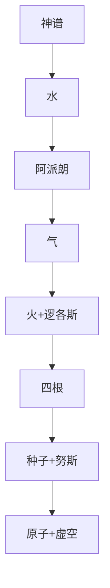

# 第二讲 希腊自然哲学

> [!abstract] 一句话
> 希腊人开始不问神、改问 [[本原]]。先按时间追「从哪来」，再按空间追「由什么构成」，最高点是 [[德谟克利特]] 的 [[原子]]。

上一篇：[[01 哲学是什么与哲学有什么用]] · 下一篇：[[03 希腊形而上学的源端]]

## 1. 结构

书中两大节：[[米利都学派]] 与 [[爱非斯学派]]；从四根说到原子论。

正文跟书走。重要关节把推论写出来。人物卡写生平与后世纪，不在这里重复履历。

---

## 2. 米利都学派与爱非斯学派

还没有实验室时，问世界的根据，大致只有两条：[[自然哲学]] 问从什么产生、由什么构成；[[形而上学]] 问何以成为它自己。把人还原成蛋白质，是左边；说人是理性动物，是右边。拆得再小，也拆不出「理性」。

> [!definition] 两条追问
> 左边是质料还原：时间上从哪来，或空间上由什么构成。右边是形式：人之所以为人的规定。本讲只吃左边。同一词 [[本原]]，问的不是同一件事。

作者开场还画了希腊哲学五块地图，本讲只吃第一块。[[历史与逻辑相统一]] 在这里第一次落地：外表是人名，内里是质料意义上的 [[本原]] 在变深。

### 2.1 [[泰勒斯]]

早期希腊人按奥林匹亚竞技会的届数记「鼎盛年」（约四十岁），泰勒斯的鼎盛年大约在公元前 585 年。米利都是小亚细亚的港口，埃及和巴比伦的历算、神话都从海上进来。20 世纪哲学史家康福德抱怨：教科书总让泰勒斯突然从天上蹦下来，说一声「本原是水」，哲学就开始了。必须先有史前史。再往前没有另一位哲学家的文字，只能追溯到神话。当时解释世界的标准答案还是神的家谱：[[赫西俄德]] 用生殖原则把杂乱的神祇排成系统——从混沌卡俄斯到大地母神盖亚，盖亚无性生下天神和海洋之神，再经泰坦神族到以宙斯为首的奥林匹斯神族。每个神象征一种自然或社会现象，神谱其实是一种朴素的宇宙发生论。海神、河神辈分最老：赫拉称河神俄刻阿诺斯为始祖；《伊利亚特》里发誓要一手抓金光闪闪的斯提克斯河、一手抓丰产的大地。希腊是海洋民族，水本来就尊贵。

再请一位更高的神，只是把家谱加一栏。他换了场地：根据不再写在奥林匹斯，而写在自然里。水既是神话里最老的东西，又是他看见种子发芽时离不开的湿润。亚里士多德后来猜他「发誓抓住最古老的」，那是后人补的心理。关键不是水对不对，是这一步：第一次用自然说明自然。丹皮尔《科学史》也把这一步看成神话到哲学。看起来是一小步，其实是从神话到哲学的一大步。

万物从水来。还说万物有灵魂——那灵魂更像稀薄嘘气，当时几乎想不出脱离肉体的精神。「本原」这个词是学生才用的，思想是他先有的。漏洞立刻出现：有规定的水很难再变成「不是水」的东西。见 [[泰勒斯]]、[[本原]]。

> [!note] 书外补
> 没有著作传世。预测日食、量金字塔是后人传说，形象是「用观察说话的人」。

### 2.2 [[阿那克西曼德]]

老师把根据放进自然，却选了一种摸得着的东西。水已经是「水」，就不能同时是火的始基。要比水更原始，只能把规定拿掉——说出「是什么」，同时就否定了「是别的」。后来斯宾诺莎说得更硬：规定即否定。用有限解释有限会循环，始基只能是无限、无定形：ἄπειρον，[[阿派朗]]。

生＝从无限里分离、获得规定；灭＝规定消掉、回到无限。冷热干湿在里面结合，生出土水火气；聚散由「命运」管。这套命运感后面接到数、[[逻各斯]]。

作者把它抬得很高：第一个真正的哲学概念，[[说不可说]] 从这里开始。正因为它说不清，才配做终极性本原，否则会被更玄奥的东西取代。中世纪否定神学对上帝只说「不是什么」，全能甚至会推出「能不能造一块自己举不起来的石头」——同一口气。它仍被当成某种说不清的**自然之物**，目的是引出有形世界，还没跳到追形式。见 [[阿那克西曼德]]。

> [!definition] [[阿派朗]]
> 无限、无定形。说出「是什么」同时就否定了「是别的」；始基只能把规定拿掉。生＝从无限里分离，灭＝规定消掉、回到无限。它还是自然之物，不是后来的形式。

> [!note] 书外补
> 残篇里还有一句演讲没展开：万物为自己的不义互相补偿。对子要还债，秩序是平衡，不是一种元素称霸。据说他做了早期世界地图，谈过地球悬在中间。

### 2.3 [[阿那克西美尼]]

水太实，阿派朗太空。要一个既能「是一种东西」、又接近无形的东西。气看不见、摸不着，但又是一种东西——作者按黑格尔叫它合题，不是他自己的口号。

冷→凝聚（气→水→土），热→稀散（土→水→气→火）。两个芽：越稀散越无定形，下一个逻辑环节是火；真正决定出场的是程度／数量，水火土气像演员，聚散像导演——预告毕达哥拉斯的数。生成论在「一种元素＋疏密」里走到头。见 [[阿那克西美尼]]。

### 2.4 [[赫拉克利特]]

米利都把本原越说越稀。爱非斯在伊奥尼亚另一头。桌上有两套东西：一边是气再稀一步就是火；一边是南意大利传来的「数／分寸」（作者认为他了解毕达哥拉斯）。若世界只是一种底料在变稀变浓，变的规矩在哪？若只有规矩，可感的火还算不算真的？

世界是一团不断燃烧、不断熄灭的活火。熄灭下降为万物，燃烧上升复归为火，像黄金换成货物、货物再换成黄金。火几乎存不住，存在方式就是烧和灭——选火，等于宣布世界首先是过程，不是一块底料。

他补了半句：在一定分寸上燃烧，在一定分寸上熄灭。这个分寸叫 [[逻各斯]]，原义是「话语」。感觉里找不到它，只在思想里定形；它既是万物的规律，也是思维该守的法则。火与万物是明线，逻各斯是暗线，两条都真，暗线更决定。他还不像后来巴门尼德那样把火贬成假的。这是自然哲学与形而上学的第一条复线。

单看「火 + 分寸」，还推不出后来叫辩证法的东西。分寸可以只是命运、数那种「背后有导演」——那是形而上学暗线。辩证法要再问：这分寸管的是什么？

管的是烧与灭、生与死如何交替。互相排斥的东西结合在一起；不同的音调造成最美的和谐；一切由斗争产生。我们身上，生与死、醒与梦、少与老是同一个东西，彼此转成对方。变化的根据在内部的对子，对子是同一过程的两端；和谐不是消灭斗争，是斗争按分寸结合。

最美的猴子比起人仍是丑的——评价随关系变。作者联想到庄子《齐物论》里的「沉鱼落雁」：今义是夸女子美，原意却是鱼见了西施躲进水底、大雁见了吓得要掉下来，人以为美的，飞禽走兽未必喜欢。推过了，没有任何尺度可靠，就变成诡辩。[[逻各斯]] 就是那条不让你滑过去的度。有变、有对、有度，三件齐，列宁才把他算成古代辩证法创始人。当时还没有这个词；智者那边是对话揭矛盾，他是独白讲事物自己怎么动。作者还提了一句：辩证法往往在一种神秘诡异的状态下才能领悟到，和他离群索居的性格是通的——点到为止。

学生克拉底鲁把「不能两次踏入同一条河」推成「一次也不能」：踏进去的瞬间河已不是同一条。只认运动、不认相对静止。反面以后是芝诺：飞箭不动。辩证法要两边一起要。见 [[赫拉克利特]]、[[辩证法]]。

> [!note] 书外补
> 出身王族，把王位让给弟弟，隐居，说话像德尔菲神谕，黑格尔都叫他晦涩。著作只剩残篇。波斯压境、城邦政争，是他厌世的背景，不是理论前提。

---

## 3. 从四根说到原子论

水、气、火都当过唯一本原，再用一种自然物解释万物，路窄了。不要再问「从哪一天开始」，改问「由什么构成」。文化中心后移雅典，但下一个人在西西里。

> [!definition] 生成论 → 构造论
> 生成论：万物从一种东西里变出来。构造论：万物由几种不能再变的底料拼出来，生＝结合，灭＝分解。时间开端逐渐被看成神学问题，空间结构才像科学对象。

### 3.1 [[恩培多克勒]]

一种元素变出万物，总像牵强。西西里听得到南意大利的比例思想。他还要保住「没有无中生有」。

水火土气四种都是本原，不互相产生，按比例结合＝生、分开＝灭。比例被他说得很具体：肌肉是等量的四根，神经是 1 分土、1 分火、2 分水，骨骼是 2 分水、2 分土、4 分火。今天听来可笑，用意是数量关系决定性质。另加爱（结合）、恨（分离），而且在四根**外面**——爱用「爱的钉子」把万物钉在一起。物质自己惰性，要外力推，[[机械论]] 从这里长。牛顿让上帝先推一把，不全是信仰：万有引力能说明已经在动的世界如何维持，不能回答最初怎么动起来。从「一」到「四」是进步，也像退步：下一位就会用更多本原。时间开端逐渐被看成神学问题，空间结构才像科学对象——直到康德和拉普拉斯的星云假说，发生学才重新进入宇宙论。见 [[恩培多克勒]]、[[四根说]]。

> [!note] 书外补
> 本人兼医生、预言者、民主派，诗体著作，投埃特纳火山是传说。爱与恨作动力，和当地医术、宗教里的结合／分离想象是通的。

### 3.2 [[阿那克萨戈拉]]

四根仍解释不了日常：吃面包为什么长出肉和头发？若每种可见物一种始基，本原数等于事物数，等于没说。苏格拉底后来打开他的书：听说有「心灵」安排万物，很高兴；读下去发现他仍用气和水去安排，失望——只要动力，不要目的。

万物还原为最小的同类部分，叫种子，无限、异质，「一切包含着一切」：最初一团混沌，运动分开之后，同类结合成万物，同类里仍带着异类，所以吃面包能长出肉和头发。表面上多解释多；暗处同一：都是种子。转化仍脆——面包里就算夹着肉的种子，为主的仍是面包的种子，为什么为主的没长出来？异质解释不了转化。种子不会自己排列，必须有一个一、同一、精神性的安排者：[[努斯]]。精神有理智，就暗含 [[目的因]]。[[逻各斯]] 是规范，努斯是冲破规范的能动——这组张力后面反复出现。见 [[阿那克萨戈拉]]、[[种子说]]。

> [!note] 书外补
> 他把哲学带进雅典，是伯里克利圈内人；说太阳是燃烧的石头，被控不敬神，逃离雅典。

### 3.3 [[德谟克利特]]

种子太杂，转化说不清。巴门尼德又说「非存在者不存在」，运动没空间发生。他和柏拉图同时，站在自然哲学那座峰上。

要不可再分的最后单元，否则分割无限、什么也不是。ἄτομον＝思想里的不可分，不是实验室粒子。去掉种子的异质：原子同质，只有形态、次序、位置，宏观的质来自排列。他打的比方是字母：n 和 o 形状不同，排成 no 或 on，词就不同。没有空的地方就不能动，必须承认 [[虚空]]：「非存在也存在」，对着巴门尼德硬刚。无数原子在虚空中做直线运动，碰撞后起旋涡，构成万物。运动是原子自己的功能，不要爱恨，不要努斯，反对目的论。感觉执着于现象，只产生暗昧的认识；理性抓住原子与虚空，才有真理性的认识。近代把哲学原子和物理原子混掉；被劈开并不推翻「不可再分的思想单元」。有一种传闻说他晚年为免受感觉愚弄刺瞎了双眼——当掌故。见 [[德谟克利特]]、[[原子]]。

> [!example] 字母
> n 和 o 形状不同；排成 no 或 on，词就不同。原子同质，宏观的「质」来自形态、次序、位置。虚空必须有，否则字母没地方挪。

> [!note] 书外补
> 老师是留基波，著作极多几乎全佚，和柏拉图保全形成对照。原子论在古代被骂无神，中世纪几乎断档。

---

## 4. 逻辑链

| 谁 | 本原 | 问法 | 动力 |
|----|------|------|------|
| [[泰勒斯]] | 水 | 生成 | 灵魂（稀薄物质） |
| [[阿那克西曼德]] | [[阿派朗]] | 生成 | 冷热干湿 |
| [[阿那克西美尼]] | 气 | 生成 | 聚散 |
| [[赫拉克利特]] | 火 + [[逻各斯]] | 生成＋复线 | 分寸 |
| [[恩培多克勒]] | 四根 | 构造 | 爱恨（外在） |
| [[阿那克萨戈拉]] | 种子 | 构造 | [[努斯]] |
| [[德谟克利特]] | 原子 + 虚空 | 构造 | 原子自运动 |

## 5. 术语与人物

**术语：** [[本原]] · [[阿派朗]] · [[逻各斯]] · [[努斯]] · [[四根说]] · [[种子说]] · [[原子]] · [[虚空]] · [[辩证法]] · [[火本原说]]

**人物：** [[泰勒斯]] · [[阿那克西曼德]] · [[阿那克西美尼]] · [[赫拉克利特]] · [[恩培多克勒]] · [[阿那克萨戈拉]] · [[德谟克利特]]

> [!tip] 这本书默认你会
> [[质料因]] 等是亚里士多德后贴的标签。见 [[四因说]]、[[预备概念与外读]]。

## 6. 复盘

- [ ] 能讲泰勒斯那一步换的是场地，不是「水对不对」
- [ ] 能画出生成论到构造论的转向
- [ ] 能说出：单有火或单有逻各斯都还不是辩证法
- [ ] 能解释原子为什么是哲学概念

> [!question]- 参考（先自己答）
> 泰勒斯：根据从神谱拿到自然。阿派朗：有规定的水当不了始基。气：有／无规定之间。赫拉克利特：火是过程，逻各斯是度，度管对子交替。四根起改问「由什么构成」。原子：同质不可分＋虚空，自然哲学到顶。
