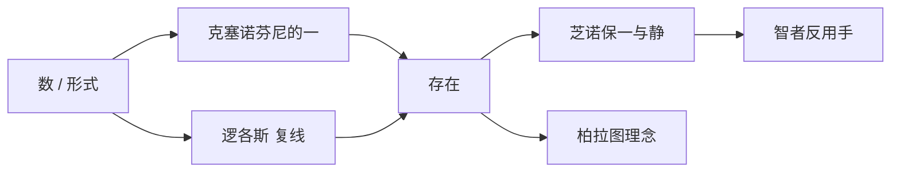

# 第三讲 希腊形而上学的源端

> [!abstract] 一句话
> 不问「由什么做成」，改问背后的形式。[[毕达哥拉斯]] 用数打开这条路，[[巴门尼德]] 把它收成「存在者存在」，[[芝诺]] 用归谬保一与静。

上一篇：[[02 希腊自然哲学]] · 下一篇：[[04 希腊怀疑论与道德哲学]]

## 1. 结构

书中两大节：毕达哥拉斯学派；爱利亚学派。上一讲走完自然哲学；这一讲只吃五块地图的第二块。

> [!example] 早期四派地理
> 爱奥尼亚（小亚细亚）：[[米利都学派]]、[[爱非斯学派]] → [[自然哲学]] ← 上一讲
> 南意大利（大希腊）：毕达哥拉斯、爱利亚 → [[形而上学]] ← **本讲**

---

## 2. 毕达哥拉斯学派

上一讲把人拆成水、气、火、原子，是时间还原或空间还原。这一讲换问法：何以成为它自己？水火还能摸到；「数」「存在」摸不到，却被说成更实在。作者宁叫这条路线 [[形而上学]]，不急贴「唯心」。西方哲学爱问背后，源端在这里。

米利都已经把本原逼到这一步：有规定的水解释不了一切有规定之物；[[阿派朗]] 能当始，却说不出它是什么；气把两边收进来，仍是一种自然物。阿那克西美尼那对冷热聚散里，真正导演出场者的，是不出场的**程度／数量**。水火土气像演员，量像导演。

他若只再换一种底料，路已经窄了。桌上另有一套材料。他精通音律，据说发明了单弦琴：一根弦、一个可移动的琴马。琴马之间的比率决定谐音差多少；他把这套比率用到天文学，发现天体间距与谐音所守的是同一种比例。这些东西管着现象，自己却不是现象。有没有一种本原，既不是水火那样的底料，也不是阿派朗那样只能否定地说的「无」？

无论从时间往回追，还是从空间往下拆，你找不到一块叫「数」的料。但任何事物都受数量关系制约，像悲剧里的命运——命运就是「定数」。比水火更高明的，不是又换了一种料，而是承认：管万物的那一项，本来就不是万物里的一项。

方法必须从还原换成抽象。

> [!definition] 抽象
> 抽掉千差万别的感性现象，去抓背后的规定和共同本质。现象是感觉的对象；本质只有思想能把握，却被认为决定事物是否成其所是。

人是理性动物，理性眼看不见，只能从言行里归纳出来；数是量的规定，手同样摸不着。本质此时还只是**量**，不是后来柏拉图那种**质**的「本身」，但已经在问形式。

他还没纯。1 既不是奇数也不是偶数，加奇数得偶数、加偶数得奇数，所以 1 是数的本原。1 是点，2 是线，3 是面，4 是体，再按不同排列构成水火土气——这边仍像自然哲学，数被做成占空间的微粒，离后来原子不远。另一边又把 1、2、4、5、8、10 象征理智、意见、正义、婚姻、友谊、完满。单看象征表，你只有教团；单看点线面体，你只是把本原几何化。两边扣上，才看得出他卡在「源端」：已经抽象，还抽不干净。

无定形等于无，无中不能生有——对着老师硬刚。可有定形若仍是水火，又退回米利都。数在思想里有定形，在现象里又摸不着：本质意义上有定形，现象意义上无定形。气想做同一件事，气仍是自然物；数才在抽象里把有定形与无定形收住。十对对立从奇偶生出来：有定形／无定形、一／多、右／左、阳／阴、静／动、直／曲、明／暗、善／恶、正方／长方。前者都优于后者。偏爱奇数、又把 10 当完满，作者说只能交给神秘。

罗素：数学是信仰永恒真理、超感世界的主要根源。勾股定理把数从形里独立成方程式。埃及人早知道 3、4、5，缺的是普遍式 \(a^2+b^2=c^2\)。无理数危机撕开数与形。等腰直角三角形斜边是 $\sqrt{2}$：感觉看见这条边，思想找不到那个整数或分数。希帕索被传说沉海。精英态度：形与数打架，该怀疑的是形。芸芸众生都有感觉，只有少数人能抽象——「眼见为虚」从这里养成。

后效两条。明线：[[赫拉克利特]] 的 [[逻各斯]] 从「分寸／比例」长出来，上一讲已经预告。暗线：数 → [[克塞诺芬尼]] 的「一」→ [[巴门尼德]] 的 [[存在]] → 柏拉图 [[理念]]。作者提醒：不要用后来的「唯心」倒灌；他要的标签是形而上学。见 [[毕达哥拉斯]]、[[数本原]]。

> [!note] 书外补
> 鼎盛约前 530。萨摩斯人，据说早年问学米利都，因政治逃到南意大利克罗顿立派。学派同时是数学团体和奥尔弗斯式教团：灵魂轮回、禁豆子、不许杀生。南意大利比爱奥尼亚闭塞，厄琉西斯、奥尔弗斯秘仪流行——作者用地理解释：东边看自然，西边看精神。豆子地传说、从狗叫声里听出亡友，当教团气质读，不当传记事实。不可通约在数学史上是第一次大危机；希帕索沉海是学派内部传说，用来记「数的完美性被撕开」即可。

---

## 3. 爱利亚学派

### 3.1 [[克塞诺芬尼]]

南意大利另一派。桌上两套神：荷马、赫西俄德那批与人同形同性的奥林匹斯神；以及已经开始抽象的「一」「数」。若神只是人形放大，埃塞俄比亚神就该是黑皮肤，狮子也会造狮形神——多神自我揭穿。他还不收无神论。嘲完诸神，背后仍要一个根据。

嘲完之后，留下的是一个不生不灭、唯一、无形、只能被思想推动万物的「一」。「一」尚未分化，逻辑结果就是数学／形而上学意义上的一。

他开创归谬。先假定那个作为「一」的神是被生成的，则只有两路：从同类生，或从异类生。从同类生等于说存在从存在里生出来，等于没生；从异类生等于无中生有。两路都堵死，故永恒。粗糙，而且带着诡辩味，但开了逻辑论证，后面芝诺、智者都用这把刀。巴门尼德把它收成 [[存在]]；多神批判被智者接着用来拆「神可知」。归谬留给芝诺，也留给高尔吉亚反手。见 [[克塞诺芬尼]]。

> [!note] 书外补
> 鼎盛约前 530，活得很长，和毕达哥拉斯、赫拉克利特谁影响谁，残篇说不清。不要和史家／苏格拉底学生色诺芬（Xenophon）搞混。见 [[易混对照]]。

### 3.2 [[巴门尼德]]

鼎盛约前 475。爱利亚富家，师从克塞诺芬尼，真正领他进沉思的却是一位毕达哥拉斯派的阿美尼亚。诗里女神领他走真理之路，并宣布别人对本原的看法都是意见。

桌上三条线已经缠在一起。米利都把水、气等可感本原说成最实在——可感物生生灭灭，说成「是」会自打。赫拉克利特两边都留：火也真，[[逻各斯]] 更决定——复线等于承认非存在也存在。毕达哥拉斯的数、克塞诺芬尼的一，已经指向思想里的东西，却还没把「只有这一项算存在」说死。

不要把他和 [[赫拉克利特]] 只看成死对头。真正对打的是米利都。赫拉克利特是居间人：火那边接米利都，逻各斯那边接他。若背后的尺度才是真的，生灭杂多还能不能并列为真？

他实际说了两句：存在者存在，非存在者不存在（也译「是者是，不是者不是」）；能被表述、被思想的才是存在。只停在第一句，你只有一句同语反复。要看他怎样从「复线」里只留暗线。

他没把存在指成某物。顺着克塞诺芬尼的一、毕达哥拉斯的数、赫拉克利特的逻各斯看，它就是本质；非存在是生灭杂多的现象。特点有四：不生不灭（沿用老师那套归谬）；唯一不可分；不变不动，永远在自身之内；时间上无始无终。空间上却像滚圆的球——受「有定形优于无定形」，球形又被看成最完满，因为球心到球面各点等距。时间无限与空间有限打架；弟子麦里梭后来改成空间也无限，高尔吉亚会拿这点做文章。

用他的词写三派公式：巴门尼德是「存在者存在，非存在者不存在」；米利都是「存在者不存在，非存在者存在」；赫拉克利特和后来原子论是「存在者存在，非存在者也存在」。执着水火土气是意见；火与逻各斯并存也是意见。只有「存在者存在」才是真理。本体论分歧对应认识论分歧。见 [[真理与意见]]。

本质眼看不见。若承认有本质，它就只能是思维对象。克拉底鲁「一次也不能踏入同一条河」从反面衬：现象说不住；能被概念说住的，不是现象。[[思维与存在的同一性]] 在这里坐实。海德格尔「语言是存在的家」，作者点一下就走。

思维与存在同一，看起来像思维与思维自己同一。到柏拉图变成思维与理念同一。作者：只有把握本质，思维才真正反映存在；若只反映感性，狗也会当哲学家。

他是数到柏拉图 [[理念]] 的中介。存在还没摔成许多理念；柏拉图会把它打碎，再按等级垒回去。智者下一讲拆这套同一：尺度说把「存在与否」交给呈现者；高尔吉亚三命题对着「存在者存在／能被思想／能被表述」逐条拆。见 [[巴门尼德]]、[[存在]]。

> [!warning] 这里的存在
> 不是「这张桌子在不在」，是「能被思想的本质」。见 [[预备概念与外读]]。

### 3.3 [[芝诺]]

学生。自己没新体系，专为老师保「一」与「不动」。自然哲学家的本原几乎都是生灭、杂多；形而上学这条线越来越把本原说成不动、唯一。常识却天天看见运动和多个东西。眼见的运动／多，能不能当证据？若不能，逻辑怎样反过来证明它们荒谬？

归谬：先假定运动／多为真，推出荒谬，再保住不动与一。和克塞诺芬尼同一把刀，用得更系统。

否运动，课上讲三个。二分法：要从 A 到 B，先走完全程的一半，再到这一半的一半，切下去永远到不了 B。阿喀琉斯追乌龟：先得到乌龟刚才出发的地方，等他到了，乌龟又往前爬了一点，如此只能无限接近，追不上。飞箭不动：每一瞬间箭都在某一点上，该瞬间只能说「在」、不能说「过」；点加起来仍是点，不动加不动还是不动。要害不是「他不承认你看见阿喀琉斯追上了」，而是只认间断、不认连续。路程可在思想上无限切，现实里运动却是连续的。当时没有极限理论，这套话能把人绕晕。目的就是颠覆「眼见为实」：逻辑比感官有力。

否多。大小论证：有部分则部分还有部分；每部分有体积则无限大，每部分无体积则等于零，两头都荒谬，故存在不能有部分。谷粒论证：问普罗泰戈拉，一粒落地有没有声？没有。一斗落地却有声，一斗由一粒一粒合成——多导致矛盾，故虚假。谷粒后来长出谷堆、秃头那些模糊学问题。

和克拉底鲁对极：克拉底鲁推绝运动／连续，口号是「一次也不能踏入」，丢掉的是相对静止；芝诺推绝静止／间断，口号是飞箭不动，丢掉的是连续。辩证法要在中间：每一瞬间既在某点上、又不在某点上。过了度，辩证法自己变成诡辩。

单有「老师说不动」不是论证；单有「把空间切碎」只是数学游戏。两件扣上：切碎是为了让运动在逻辑里活不成，常识证据才失效。

正面：培养重推理、轻感觉的习惯，形而上学靠它往下长。反面：诡辩是双刃剑。高尔吉亚用同一套反证，把「一与静」也拆掉。麦里梭把球体改成空间无限，给高尔吉亚提供弹药。见 [[芝诺]]。

> [!note] 书外补
> 鼎盛约前 468。据说密谋反对僭主，拒供同谋，酷刑而死。亚里士多德称他为辩证法奠基者之一——武器是归谬，不是赫拉克利特那种独白讲事物自己如何转。两个芝诺：他 ≠ 斯多葛创始人 [[季蒂昂的芝诺]]。

---

## 4. 逻辑链

| 环节 | 本原／说法 | 方法 | 留给下一讲 |
|------|------------|------|------------|
| [[毕达哥拉斯]] | [[数本原]] | 还原 → 抽象 | 形数打架，疑形 |
| [[克塞诺芬尼]] | 思想之神＝一 | 嘲多神 + 归谬 | 论证习惯 |
| [[巴门尼德]] | [[存在]] | 切断复线 | [[思维与存在的同一性]] |
| [[芝诺]] | 一与静 | 归谬保老师 | 智者反手 |

## 5. 术语与人物

**术语：** [[数本原]] · [[存在]] · [[真理与意见]] · [[思维与存在的同一性]] · [[形而上学]]

**人物：** [[毕达哥拉斯]] · [[克塞诺芬尼]] · [[巴门尼德]] · [[芝诺]]

易混：[[芝诺]] ≠ 斯多葛那个芝诺；[[克塞诺芬尼]] ≠ 色诺芬。见 [[易混对照]]。

> [!tip] 这本书默认你会
> 这里的 [[存在]] 不是「这张桌子在不在」，是「能被思想的本质」。海德格尔那句只是点到，自序说了不讲现代，不必顺链外读。见 [[预备概念与外读]]。

## 6. 复盘

- [ ] 能讲清：音程比例或数字象征各自停在哪，两件怎么扣上才是形而上学源端
- [ ] 能说明数为什么比水火更高明，却还没纯
- [ ] 能写出三派关于存在／非存在的公式
- [ ] 能指出芝诺论证的要害（间断 vs 连续），以及它和克拉底鲁怎样对极

> [!question]- 参考（先自己答）
> 单有比例＝经验观察，单有象征＝巫术；数还原不到水火、却制约万物，方法从还原换成抽象，再在思想里收住有定形／无定形，才是源端。数仍与点线面体、象征搅在一起。巴门尼德：存在者存在，非存在者不存在。米利都：存在者不存在，非存在者存在。赫拉克利特／原子论：两者都存在。芝诺只认间断、不认连续，用逻辑压「眼见为实」；克拉底鲁只认连续。
