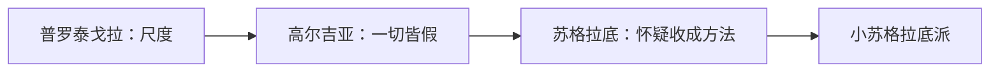
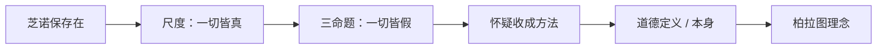

# 第四讲 希腊怀疑论与道德哲学

> [!abstract] 一句话
> [[智者]] 拆掉独断的本原；[[苏格拉底]] 把怀疑收成方法，要在道德上重立本质。皮浪那一系放到第六讲。

上一篇：[[03 希腊形而上学的源端]] · 下一篇：[[05 希腊实在论哲学]]

## 1. 结构

书中两大节：智者派；苏格拉底的道德哲学。真正的对峙不是唯物／唯心，而是 **[[怀疑论]] vs [[独断论]]**。

> [!example] 本讲只吃早期怀疑
> 智者＝方法上的相对／怀疑。希腊化的 [[皮浪]] 在第六讲。两条有思想联系，不是同一场。

---

## 2. 智者派

芝诺用诡辩撑 [[存在]]。诡辩是双刃剑：保一与静的同一套反证，也可以拆一与静。智者学会以其人之道还治其人之身。

唯物、唯心两边都是独断的实体论，都先设定一种本原再往下讲。怀疑论攻击的是这块地基。作者把智者看成从源端到柏拉图／亚里士多德的**否定性中介**；苏格拉底是**肯定性中介**——怀疑只当方法，要在道德上重立本质。

> [!note] 书外补
> 前 5 世纪雅典崛起，民主与诉讼要口才。智者收费教辩论，浪迹城邦。苏格拉底、柏拉图、亚里士多德都瞧不起「批发灵魂食粮」。sophist 后来才变成贬义「诡辩家」。西塞罗说苏格拉底把哲学从天上拉回人间；作者纠正：[[普罗泰戈拉]] 已经先转了。

### 2.1 [[普罗泰戈拉]]

爱利亚把唯一、不动的存在当本原。各派却各执一词：水、火、数、存在。赫拉克利特的尺度还是客观的、一个的。若人人都用自己的眼睛看世界，还怎么坚持「只有一个尺度」？

两句要一起记：[[人是万物的尺度]]——是存在者存在的尺度，也是不存在者不存在的尺度；一切理论都有相反的说法。只停在「相对主义」四个字，你只有结论。要看尺度怎样从客观碎成一人一尺。

尺度原先是赫拉克利特的分寸、巴门尼德的存在——唯一、客观。他不另造一种本原，只改尺度的主人。事物对于你就是向你呈现的样子。风本身冷不冷，问法非法；只能说对感觉者如何。神、存在、逻各斯都不可知：「问题晦涩，人生短暂。」

人是个体，有多少人就有多少尺。客观的一碎成主观的多。以前各派争执本原，在他看来正好证明：本原就是你眼里、你推论里的那个东西。被米利都当作存在的，巴门尼德叫非存在——尺度在各人。感觉因人而异是常识，哲学家各说各话也只是观察；把尺度的主权交给呈现者，才对着爱利亚拆。

每人用自己的尺衡量的世界都真。可若彼此对立的看法都真，就没有任何看法是真。逻辑下一步是高尔吉亚「一切皆假」。「一切理论都有反说」会自我颠覆：它自己也是理论，也该有反命题。学费官司：师生用同一逻辑对打——无论胜负，钱都该交／都不该交。柏拉图评：既毁别人，也毁自己。

哲学主题从自然／存在转到人。和苏格拉底「认识你自己」同：都收回人。异：尺度拆成孤独个体；认识你自己要达到普遍规定。生活里他仍要吃饭——作者点到后来休谟：习惯是人生指南。智者多为方法上的怀疑，为辩而辩。见 [[普罗泰戈拉]]、[[人是万物的尺度]]。

> [!note] 书外补
> 约前 490—前 420，阿布德拉人（与德谟克利特同乡），两到雅典，和年轻苏格拉底辩过。柏拉图对话里他是对手，不是传记。

### 2.2 [[高尔吉亚]]

普罗泰戈拉走到一切皆真＝无真。芝诺已经证伪多和运动。若「一与静」也假，就无物存在。爱利亚留下的最后据点——存在者存在、思维与存在同一、同一能被说——能不能用老师那套反证拆掉？

三命题：无物存在；即使有也无法认识；即使认识了也无法告诉别人。纯逻辑游戏，不管常识——和芝诺不管你看见运动一样。

假定有物，只有三路：非存在者存在；存在者存在；两者都存在。第一、第三，爱利亚自己已经证伪，他借用。自己要做的是证伪「存在者存在」：永恒／派生／既永恒又派生。派生，克塞诺芬尼、巴门尼德驳过。既永恒又派生，自相矛盾。永恒：麦里梭说时间永恒则空间无限；无限者与场所的关系——小于场所则非无限，等于场所则一物既是物又是场所，大于场所则无处在。三路堵死，存在者不能永恒，故「存在者存在」倒。芝诺拆多与动，他拆一与静。

第二命题对着「能被思想的必定是存在」：思维穷尽仍找不到存在；能想「人在天上飞、马车在海上跑」，能想的不必存在。第三命题对着「存在—思维—言说」一条链：看过的画，用语词说给别人，对方没有同一份看。思维与语言也不是同一。

他本人不会真认为没东西存在，否则活不到一百多岁。关起门来诡辩，出门仍按习惯生活。正面遗产：形式逻辑的技术；芝诺证伪非存在、他证伪存在，对立面凑齐，离对话辩证法只差一步。苏格拉底把这套「揭矛盾」收成方法，不再为辩而辩。见 [[高尔吉亚]]。

> [!note] 书外补
> 前 483—前 375，西西里人，师从芝诺和恩培多克勒，活了一百多岁。三个命题针对巴门尼德三句，不是另立宇宙论。

---

## 3. 苏格拉底的道德哲学

雅典人，前 469—前 399。年轻赶上伯里克利盛期，晚年赶上伯罗奔尼撒战争后民主制回光返照。被控不敬神、败坏青年。述而不作，思想靠柏拉图与色诺芬（≠ 克塞诺芬尼）。

智者已经拆掉独断本原。城邦却仍要问：正义是什么、美德是什么。不能退回水火原子——他认为自然本原只有神配认识。也不能停在一人一尺——那样没有可教、可共的「本身」。怀疑之后，还能不能在人身上重立一种普遍本质？

智者的刀他不扔，改刀口朝向。德尔菲说无人比他更有智慧。他发现别人不知自己无知。人配不上智慧，唯神配。「认识你自己」：由己达神。人之根本是道德，不是自然本原。和尺度说同：都收回人。异：尺度拆成孤独个体；这里要达到美德的普遍定义。

早年喜 [[努斯]]，惜其只给动力、不给目的。狱中劝人看眼睑、牙齿的合用——不像偶然。当时没有进化论，和谐被读成神意。本原总账补上第四项：[[目的因]]。质料、形式、动力已经有了；神按目的安排，才解释「为什么恰好这样」。亚里士多德 [[四因说]] 在此预告。

骗朋友恶、骗敌人可以是善；枚举行为给不出美德之为美德。具体善行相对，「善」本身不相对。行为是不是善，取决于是否认识「善」本身。无人有意作恶：作恶出于不知善有益、恶有害。逆命题：知识即美德，无知即罪恶。开西方伦理学唯智主义。这就是 [[美德即知识]]。

已知不必学、未知不能学——知识悖论。善的知识介乎已知与未知。柏拉图用 [[回忆说]] 解：灵魂曾有、入身遗忘、感觉触媒。方法上：自己不先立论，不断问，揭矛盾。先问「是什么」，再问「是什么样」。普遍定义到柏拉图就是 [[理念]]。过程重于当场结论。母亲接生身体，他接生定义——精神接生术。辩证法在他这里是对话，不是赫拉克利特那种独白。

单有「认识你自己」可以是箴言；单有问答可以是智者课。刀口对准定义、对准善本身，怀疑才收成方法。

拒越狱：好的生活重于活着。作者看成 [[向死而生]] 的唯灵苗头——死不是轮回终点，是灵性生活开端，为基督教开先河。词是后世的，当课堂修辞。

分期：泰勒斯开自然哲学，毕达哥拉斯开形而上学，他开道德哲学。否定之否定：早期追本质 → 智者否定 → 他在道德上重建 → 柏拉图把「善」泛成世界最高理念。亚里士多德嫌只见理智；卢梭后来认为知识增而德衰；康德把实践理性与理论理性分开。麦加拉把辩证法再诡辩化；犬儒把伦理推到反习俗。见 [[苏格拉底]]、[[美德即知识]]。

> [!note] 书外补
> 父雕刻、母助产。参加过战争，得过嘉奖。拒称智者，自居爱智者——「哲学家」在他这里坐实。公元前 399 年死刑。恢复的民主制已失内涵，作者不让你只因为「民主处死他」就把他写成反派。柏拉图早年对话较近老师，晚年常借他的嘴说自己的话——哪些算苏、哪些算柏，本来分不清。

### 3.1 小苏格拉底派

苏格拉底死后，追随者被逐，在外邦立派，通称小苏格拉底派。观点互异，常把老师推到极端。

- **麦加拉**：欧几里得（≠ 几何那个）。欧布里德：说谎者、谷堆、有角人。有的是悖论，有的是诡辩（有角人：没失去的都是我的 → 我有角）。动机仍是：个别自相矛盾，普遍才真。
- **犬儒**（昔尼克）：安提斯泰尼、第欧根尼。苏的伦理 × 智者相对：以自然反习俗。第欧根尼住桶，对亚历山大说「不要挡住阳光」。影响希腊化。形式上学嬉皮，作者要你看思想内涵。

> [!note] 书外补
> 麦加拉的欧几里得 ≠《原本》的欧几里得。见 [[易混对照]]。

---

## 4. 逻辑链

独断本原 → 智者拆（尺度／一切皆假）→ 苏格拉底用怀疑当方法重建道德本质 → 柏拉图做成理念。

## 5. 术语与人物

**术语：** [[怀疑论]] · [[独断论]] · [[智者]] · [[人是万物的尺度]] · [[目的因]] · [[美德即知识]] · [[向死而生]]

**人物：** [[普罗泰戈拉]] · [[高尔吉亚]] · [[苏格拉底]]

> [!tip] 这本书默认你会
> [[美德即知识]]、智者不是骂人、[[向死而生]] 是后世用词。伯罗奔尼撒战争、德尔菲神谕当背景即可。见 [[预备概念与外读]]。

## 6. 复盘

- [ ] 能讲清：风冷不冷因人而异停在哪，尺度的主权怎样交出去才拆掉本原
- [ ] 能区分智者的拆和苏格拉底的方法
- [ ] 能讲清「一切皆真」如何自我颠覆，以及高尔吉亚三命题对打巴门尼德哪三句
- [ ] 能说出四因在本讲补上了哪一因，以及美德即知识怎样从「具体善行相对」推出来

> [!question]- 参考（先自己答）
> 感觉相对是常识；把尺度从客观的一改成主观的多，存在与否随呈现者，才对着爱利亚拆。智者为辩而辩；苏格拉底用同一套揭矛盾去重建普遍定义。尺度说「一切皆真」自己也该有反命题，等于无真。高尔吉亚：无物存在／无法认识／无法告诉别人，对打存在者存在／思维与存在同一／同一能被表述。本讲补上 [[目的因]]。具体善行相对，善本身不相对，所以美德是关于善的知识，不是一堆行为。
