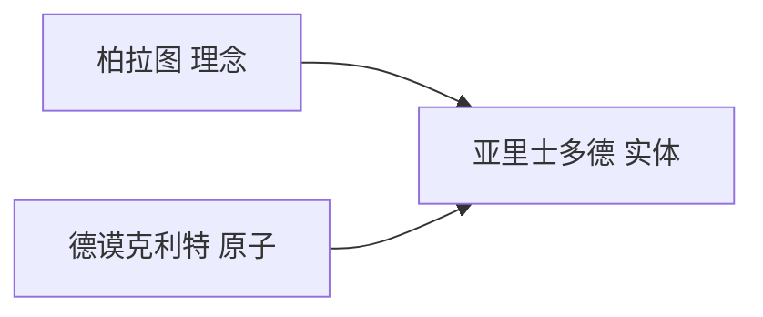
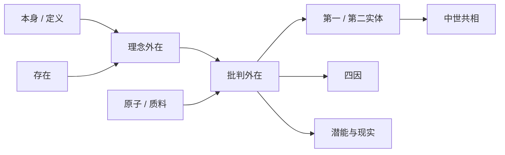

# 第五讲 希腊实在论哲学

> [!abstract] 一句话
> 苏格拉底的「本身」，[[柏拉图]] 做成独立的 [[理念]]；[[亚里士多德]] 批判理念外在，却用 [[实体]]、[[四因说]]、[[潜能与现实]] 把两峰收成一座更高、也更妥协的实在论。

上一篇：[[04 希腊怀疑论与道德哲学]] · 下一篇：[[06 希腊哲学的衰颓]]

## 1. 结构

书中两大节：柏拉图哲学；亚里士多德哲学。两座峰，一个合题。

源于毕达哥拉斯的形而上学，经智者否定、苏格拉底重振，到柏拉图做成系统；亚里士多德要把理念论和原子论两边都装进去——伟大，也因此有裂缝。

德谟克利特和柏拉图同时代，表面上死敌。作者提醒：两边都抓背后的东西，都贬感觉（真理性的认识 vs 暗昧的认识；真理 vs 意见）。原子和理念都可以看成摔碎的巴门尼德存在。怀疑论才是两边共同的敌人。亚里士多德看见这种同构，才去做合题。

> [!note] 书外补
> 学园传到 529 年，著作大体保全；原子论著作命运相反。不是因为「唯心战胜唯物」，是传承、罗马、教父一路选中了柏拉图。

---

## 2. 柏拉图哲学

前 427—前 347。贵族。老师被处死后流亡，三赴叙拉古几乎被卖，前 387 年办学园（Academy）。

桌上几样都在，却对不上。苏格拉底的「本身」、普遍定义，主要停在道德范畴，没说可以离开具体事物独立。巴门尼德的存在唯一、与现象隔开，太「一」，解释不了桌子、马、正义许多种。克拉底鲁说万物皆流，现象不可靠，但还没有「先有的知识从哪来」。智者把本质拆掉，又不能退回一人一尺。

「本身」若真能说明许多个同类事物，它能不能只是思想里的定义、寓于个别之中？知识悖论——已知不必学、未知不能学——怎么解？

idea／eidos 原义是「看」，这里是精神看见的形相，不是肉眼看见的现象。译成「理念」容易听成心里的念头，译成「理型」又丢掉主观那一面；课上从俗，作者宁称形而上学实在论。和老师两处分叉，是推出来的，不是宣布的。

苏格拉底谈美德、正义、善，不谈桌、马；「本身」寓于个别之中，图形本身仍在各种具体图形里，并没有被说成可以离开具体事物独立。柏拉图把「本身」推广到万物，并且切开：理念独立于、先于具体事物和我们的头脑。每张具体桌子都有缺陷（太窄、会朽、石头的太冷、塑料的不结实）。若「桌子本身」只是这些桌子的共性，共性也会带着缺陷。他要一个无缺陷的桌本身，作为有缺陷者的根据。定义若只寓于个别，个别有缺陷，定义会被拖脏。

> [!example] 拿掉木匠，留下理念
> 木匠打造桌子之前，头脑里已经有一个桌子的理念。质料和形状各不相同的桌子，没有人会当成柜子。现在拿掉这位木匠，却留下他头脑里的桌子——这就是理念论。作者还用另一个比方：拿掉上帝、留下上帝心中的观念，也是同一套。

后来中世纪才说死「结果不能大于原因」，作者认为当时已在起作用。完美的理念若是结果，不完美的桌子倒是原因——说反了。所以理念先于、外在于事物；事物 [[分有]]、摹仿理念。一个东西之所以是美的，是因为美本身出现于它之上，或为它所分有。分有总不完全，所以模本有缺陷。摹仿也是同一方向：原本先于、优于模本，《蒙娜丽莎》和复制品。摹仿在毕达哥拉斯那里已有（事物摹仿数）；分有是他独创。

巴门尼德把流变直接叫非存在，太狠，也违常识。他改成量的层级：真非存在是无形式的原始物质（原子论被贬在这里）；感觉物在存在与非存在之间；理念是存在。理念给形式、目的、动力——物质被说成惰性，要精神来推。善本身在金字塔顶。工匠神德穆革按理念赋形，不是从无创造——和《圣经》不同。

真知若来自感觉，理念先于事物就垮；若不来自感觉，美诺悖论怎么解。灵魂曾居理念界，入身遗忘，感觉只是触媒（看见亡友的琴想起亡友——知识不从琴来；童奴没学过四则，被问出来——他读成「本来有」）。[[回忆说]]：学习即回忆。洞喻、线喻是同一条上升：从影到善本身。

单有定义不是理念；单有「背后有本质」是巴门尼德。切开、先在、分有，三件齐。

> [!definition] [[理念]] 三件齐
> **切开**：理念不寓于个别，独立于具体事物和头脑。**先在**：无缺陷者是因，有缺陷者是果。**分有**：事物摹仿理念才成为「这一个」，分有总不完全，所以模本有缺陷。少一件，就还是苏格拉底的「本身」，或巴门尼德的存在。

理念六级：自然物 → 人造物 → 数理 → 范畴 → 道德审美 → 善本身。下一级以上一级为目的。形式 + 质料 = 感觉物。铜像例到亚里士多德还要用：决定「这一个」的是形式，不是那堆铜。

洞喻是囚徒转头。生来面壁、手脚被捆的人，只看见火光投在石壁上的木偶影子。一个人挣脱枷锁，先回头看见木偶和火，才知道墙上的是影；再走出洞口，看见真实的人和物，才知道木偶也是假的；最后眼睛能对着太阳，才发现大地上的万物靠阳光才显现。影 → 木偶 → 实物 → 太阳，对应摹本的摹本、感性事物、理念、善本身。上升靠灵魂不断「回头」。

线喻是同一条线切开的认识等级。左边意见对应感觉世界，右边真理对应理念世界；原始物质那边是无知，根本不入知识。意见再切：想象（影像、艺术品——摹本的摹本，所以他轻视艺术）→ 信念（感觉物，比想象可靠，可当触媒）。真理再切：理智（数理理念，还沾形，一说「图形」就想到三角形）→ 理性／[[辩证法]]（范畴之间纯概念推演，完全不靠感性中介）。通种论：对立范畴在更高者中统一。「一是一」已经暗含两个相同的东西，因而暗含多；「一存在」在「一」之外加了「存在」，也不再是单纯的一。芝诺证「多其实是一」，他要表明「一其实是多」。作者点到黑格尔。外读只补《理想国》第六–七卷。

理想国：国家是放大的个人。灵魂三部分——理性、意志、欲望——各有美德：智、勇、节；三部分各得其美德，整体才有正义。国家三个等级对上这三部分：统治者用金做成，美德是智慧；保卫者用银，美德是勇敢；劳动者用铜铁，美德是节制。各安其分则正义。这四种美德后来叫古典四德，和基督教的信望爱不是一套。第一、二等级财产公有，婚姻由国家按优生安排。最有智慧的人该治国，所以要哲学王：要么哲学家做王，要么王者认真研究哲学，否则国家不得安宁。作者：哲与政难兼；唯一身兼的马可·奥勒留反而是悲观斯多葛，而且开启了帝国衰落——没给哲学王提供正面证据。

后效：中世 [[唯实论]]、新柏拉图、教父。亚里士多德第一刀就砍在「外在理念把事情搞复杂」。见 [[柏拉图]]、[[理念]]、[[分有]]。

> [!note] 书外补
> 翻译之争（理念／理型／相）课上从俗用「理念」，记住：不是心里的念头。德穆革是建筑师，不是无中创世的上帝。洞喻、线喻他当人人读过。

---

## 3. 亚里士多德哲学

「吾爱吾师，吾更爱真理。」前 384—前 322。色雷斯人，十七岁入学园近二十年，教过亚历山大，回雅典办吕克昂，一边散步一边讲——逍遥派。亚历山大死后被反马其顿势力逼走，次年去世。

气质：柏诗人，亚科学家。罗素：热情与审慎的冲突，贯穿西方哲学。他要研究的是个别实在物；老师却在个别之外另立理念世界，分有、摹仿被他叫「诗意的比喻」——既解释不清个别如何分有，又让人多研究一套世界。

同时，原子论已经把质料推到顶。两峰同构（都是实在论），内容相反。他若只站一边，做不成集大成；两边都装，体系必有裂缝。作者比康德：两大调和者都伟大，也都内含裂缝。

不要外在理念，又不要把「是什么」说成只是一堆属性；个别物怎样既是最实在的，又能被种属述说？生成怎样既不是无中生有，也不是诗意分有？

三个问题连着问：实体是什么 → 原因是什么 → 如何生成。这不是章节目录，是推论顺序。第一哲学从感觉、记忆往上收：个别经验 → 普遍技术 → 理论；对象不是特殊存在物，是「作为存在的存在」。17 世纪才有人把这部分叫 ontology。

前人争存在是一还是多、动还是静，指出过「什么是存在」（理念、原子），没问「存在是什么」。种加属差对「存在」失效：人是有理性的动物，动物上面有生物，生物上面有物质，物质上面是存在，存在上面再没有更大的种。只能从内涵分类。偶性——白、文明——变了主体还在；十范畴（实体、数量、性质、关系、地点、时间、姿态、状态、动作、遭受）则是必然的，缺一不可。十范畴里 [[实体]] 撑起其余：「是什么」逻辑上先于「怎么样」。先知道亚里士多德是一个人，才谈得上他在哪里、长什么样。

最严格的实体＝既不述说一个主体，也不依存于一个主体。种属能述说「苏格拉底是人」；属性「白的」依存于主体。两刀切下来，只剩个别的人、个别的马。四个特点：这一个；无相反者（没有一个与苏格拉底相反的东西）；无程度差（不能说张三比李四更是一个人）；变中之不变（年轻年老都是他）。和理念正对：理念是种属，他的第一实体是个别。

他马上让步——种属是第二实体。「人」能述说苏格拉底，也能被「动物」述说，且不依存于一个主体。第一实体更实在；第二实体只满足「不依存」。裂缝从此留下：若种属也是实体，理念就部分回来了；若种属独立只是逻辑上的，现实里它仍是抽象。中世 [[共相]] 之争咬这里。

> [!definition] 第一实体 / 第二实体
> 第一实体＝个别的人、个别的马：既不述说一个主体，也不依存于一个主体。第二实体＝种属：不依存，但能述说。他要个别最实在，又要种属撑起定义和科学——两件硬装在一起。

原因收成四因。房子：砖瓦＝质料，蓝图＝形式，工匠＝动力，居住＝目的。橡树：种子是质料，长成的橡树同时是形式、动力、目的——驱使种子生长的，不是种子自己，是它所要长成的那棵树。自然物里后三因并入形式。

> [!example] 房子和橡树
> 人造物上四因分得清：砖瓦、图纸、工匠、居住。自然物上后三因并入形式：那棵将成的橡树，既是种子要长成的样子，也是推动它长的力，也是它的目的。

世界做成阶梯：泥巴对砖是质料，砖对房子是质料，低级是高级的质料。无限追溯对希腊人没有意义，两端必须封口：顶端纯形式＝第一推动者／神，底端纯质料（原子／原始物质被安在这里）。口头综合两家，心偏向柏拉图：铜像里决定「这一个」的是苏格拉底的形相，不是那堆铜；形式「更是实体」，又与「实体无程度差」打架。

生成＝潜能实现为现实，不是无中生有，也不是分有。种子是潜在的橡树：不是石头（石头无此潜能），也还不是橡树。随便把一堆蛋白质扔在地上，不会自动组合成人——原因怎样变成这个事物，前人没说清。

> [!definition] [[潜能与现实]]
> 生成不是从无到有，也不是分有一个外在理念。同一事物的两种状态：还不是、但能够是（潜能）；已经是（现实）。石头没有「成为橡树」的潜能，种子有。

运动定义更宽：产生消灭、性质变、增减、位移——都是从潜能到现实。[[隐德来希]]：内在目的之实现。有机论：动力在内在目的，不是纯外推。吸铁石吸钉子，磁力来自吸铁石，可钉子若没有磁性也不会被吸；木头怎样也不会。柏拉图的分有、恩培多克勒的爱钉，在他看来都是神话；潜能—现实才是同一事物的两种状态。

只有「个别最实在」，解释不了种属、定义、科学；只有「形式更是实体」，个别成了第二位。第一实体＝个别，又让形式做原因和目的——裂缝里的综合，才是这座蓄水池。

用四因回看前几讲（古人没这张表，作者后贴）：

| 前几讲说法 | 主要落在 |
|------------|----------|
| 水、气、火、四根、种子、原子 | [[质料因]] |
| 爱恨、[[努斯]]、原子自运动 | [[动力因]] |
| 数、[[存在]]、[[逻各斯]]、[[理念]] | 形式 |
| 苏格拉底看眼睑牙齿、善本身 | [[目的因]] |

完整表也在 [[四因说]]。十范畴是存在分类，和康德十二范畴不是一套，见 [[范畴]]。

作者收束：这座蓄水池流出中世共相之争和近代分流。唯心抓「形式更是实体」，唯物抓「第一实体更实在」。有机论比后来牛顿式位移更高明，也更容易滑向设计论／神学——他不讳言。见 [[亚里士多德]]、[[实体]]、[[四因说]]、[[潜能与现实]]。

> [!note] 书外补
> 弟子编「物理学之后」＝ [[形而上学]]。他称第一哲学：作为存在的存在。17 世纪才有人把这部分叫 ontology。黑格尔盛赞他与亚历山大的师生；罗素认为影响近于零——作者两边都点，不替你选。

---

## 4. 逻辑链

## 5. 术语与人物

**术语：** [[理念]] · [[分有]] · [[回忆说]] · [[实体]] · [[四因说]] · [[潜能与现实]] · [[隐德来希]]

**人物：** [[柏拉图]] · [[亚里士多德]]

> [!tip] 这本书默认你会
> 洞喻／线喻、十范畴、第一推动者、德穆革。见 [[预备概念与外读]] 第 2 节。四因看《物理学》第二卷选段即可。

## 6. 复盘

- [ ] 能讲清：苏格拉底的「本身」停在哪，切开、先在、分有怎样推出来
- [ ] 能指出第一／第二实体的裂缝，以及它和共相之争的关系
- [ ] 能用四因把前几讲本原说法对上号
- [ ] 能说明：个别最实在、形式更是实体，两件怎么硬装在一起

> [!question]- 参考（先自己答）
> 苏主要谈道德范畴的「本身」，且寓于个别；柏推广到万物，并用「结果不能大于原因」让理念先于、外在，事物分有／摹仿。第一实体＝个别，第二实体＝种属——个别最实在，种属又要能被述说，中世共相之争咬这里。水火原子对质料，爱恨努斯对动力，数／存在／理念对形式，眼睑合用对目的。只有个别＝经验；只有形式优先＝柏拉图；他两头都要，所以裂缝。
