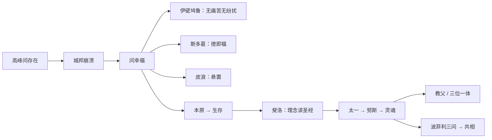

# 第六讲 希腊哲学的衰颓

> [!abstract] 一句话
> 城邦垮了，哲学从问本原变成问「不幸世界里如何幸福」。三派貌反神同，经新柏拉图把客观形而上学送进基督教。

上一篇：[[05 希腊实在论哲学]] · 下一篇：[[07 中世纪基督教哲学]]

## 1. 结构

书中两大节：希腊化时代的三大学派；罗马帝国时期的哲学过渡形态。

作者口味很硬：希腊化回流带来专制与纵欲，哲学蜕为伦理学。先当讲述立场，不必全盘接受。第一讲已提醒：他视放弃本质为低谷。

> [!warning] 两个芝诺
> 爱利亚的 [[芝诺]] ≠ 斯多葛创始人 [[季蒂昂的芝诺]]。

---

## 2. 希腊化时代的三大学派

亚历山大把希腊文化推到东方，东方的专制、享乐也回流。这里的「东方」指巴比伦、波斯、埃及，不是中国、印度。城邦制度瓦解，财富涌入。希腊人原先过的是理智的自然主义：既不禁欲，也不纵欲。城邦一散，人越来越把个人享乐看得比神、国家更重，作者给这种「清醒」加引号，意思是自我意识膨胀，不是真的看透了。

桌上的问题因此换了。亚里士多德以前，哲学还在问 [[本原]]、[[实体]]，知识本身可以当目的。现在没人再关心背后的东西，只问：在这个不幸的世界里，人如何获得幸福？黑格尔说三派貌似对立，共同点是对现实漠不关心。作者把这种提问叫末世提问：一个文化走到末段，才会只剩「我怎么活得下去」。

> [!definition] 衰颓
> 不是忽然没人思考，而是提问从「世界是什么」滑到「不幸里如何自保」。哲学由引导真理的火炬，变成跟在经验生活后面的救护车。

主题因此从本原转到生存意义。希腊哲学问世界；基督教问被绝对化的人类精神。上帝与原子、理念都是现象背后的东西，但上帝管人的生存，原子和理念不管。这一转，才接得上后面的教父。

> [!note] 书外补
> 罗马人自己几乎没创哲学，共和国末期才从希腊拣伦理学。伊壁鸠鲁主义、斯多葛主义一直活到帝国。三派表面对打，提问方式却是同一个。

### 2.1 [[伊壁鸠鲁]]

前 341—前 270。亚里士多德还把哲学写成 [[学以致知]]：求知本身就是目的，不必落实到日子里。伊壁鸠鲁把目的改成「寻找生活宁静之道」。知识若不能去掉苦恼，就不值得追。哲学因此通俗化、生活化，也离开了 [[形而上学]]，变成一种实践的智慧。幸运还是悲哀，作者交给听众。

怕神（自然异象）、怕死、与人不和，三样搅得灵魂不安。德谟克利特的原子世界铁一般必然，命运同样可怕。不靠外在本原崇拜，怎样去掉两个恐惧加一个人际麻烦，让身体无痛苦、灵魂无纷扰？

> [!definition] 幸福（伊壁鸠鲁）
> 用否定句写，不说幸福是什么，只说幸福不是什么：身体无痛苦，灵魂无纷扰。节制生活对身体；灵魂要对着三因下药。这不是后来被贴上的纵欲标签。

异象不必是神怒。他继承 [[原子]] 论：世界由原子在 [[虚空]] 里构成。神可以有，但只住在不同世界的缝隙里，从不干预。电闪雷鸣有自然原因，与神的喜怒无关。承认神又把神流放出去，作者叫他古希腊的无神论者。

德谟克利特的原子同质，只有形状、次序、位置，只能做直线运动。伊壁鸠鲁加了两刀。第一刀是重量：重量不同，速度不同；这个成见一直影响到伽利略之前，比萨斜塔的故事要推翻的，正是「重的落得更快」。第二刀是偏斜。偏斜看起来像物理学，其实是把偶然加进铁的必然：原子可以偏离预定轨道，背后暗示自由意志。马克思的博士论文就做这个。伊壁鸠鲁本人首先关心的不是自由理论，而是：变化无常与神无关，所以不必怕。

感觉最可靠，死才不足惧。德谟克利特贬感觉，只把理性对原子和虚空的认识叫真理性的认识。伊壁鸠鲁反过来：感觉是真理的见证和报导者；出错不在感觉，在理智对感觉的误解。相同的感觉驳不了相同的感觉，不同的感觉也驳不了不同的感觉，理性与感觉完全不同，更加驳不了。既然只能靠感觉认识世界，就用感觉看死亡：活着的时候感觉不到死；死了消散为原子，没有感觉。未知才可怕，「好死不如赖活」常常是因为死后是空白。他把死后说成「无感」，从理论上拆恐惧。解释未必让人满意，但逻辑上够用。

人际用契约。继普罗泰戈拉之后，他再一次明确讲 [[社会契约]]：大家按约办事，麻烦就少。不守约，至少还可以退出，独善其身，潜心研究。消极，但够让灵魂不受人际撕扯。

单有「追求快乐」，是后世纵欲标签——他的快乐是无痛苦、无纷扰。单有原子论，可以仍怕死、怕神。用原子论拆恐惧，幸福才落成否定句。

弟子把伦理学收成四药方：神不足惧，死不足忧，乐于行善，安于忍恶。越传越消沉；罗马晚期被说成醉生梦死，和斯多葛对打。作者：本人是审慎的节欲，主义被传成纵欲。见 [[伊壁鸠鲁]]。

> [!note] 书外补
> 本人尚节俭，不是后世「纵欲」标签。污名很大程度从西塞罗（斯多葛立场）传开；弟子是否有败家子，作者存疑。孟德斯鸠后来把希腊罗马的堕落算在「伊壁鸠鲁主义」头上——先把本人和主义分开。

### 2.2 [[季蒂昂的芝诺]]

约前 334—约前 262。塞浦路斯人。和伊壁鸠鲁同一时代问题：纷扰世界里如何不动心。路径不能再是「快乐即幸福」——快乐太容易被听成放纵，也解释不了为何受苦仍要有德。若世界背后仍有理性／命运，服从它算不算自由？有德本身能不能就是幸福，而不靠快乐来定义？

赫拉克利特的火被说成有灵魂的世界大火，[[逻各斯]] 是世界理性。每人分有一点火花。四海之内皆兄弟——早期斯多葛反奴隶制、世界主义，亲马其顿。城邦与城邦没有本质差别，人与人不应有阶级之分。

若逻各斯就是命运，抗争只加痛苦。自由＝认识并服从必然。近代 [[斯宾诺莎]]、[[黑格尔]]、[[马克思]] 还在这条线上，语气积极得多：认识世界是为了按规律办事，甚至改造世界。斯多葛停在伦理学：认识不是为了改造，是为了顺其自然、逆来顺受。道德生活＝顺应自然；[[美德即幸福]]，对打伊壁鸠鲁的快乐。一个把美德等同于幸福，一个把快乐等同于幸福，美德与快乐从此对立。后世把一边听成纵欲，一边听成禁欲，水火不容；误解有，伊壁鸠鲁的「快乐」本身也容易被听歪。

只有「服从命运」是宿命口号；只有「要有美德」苏格拉底已经说。世界理性 × 德即福、不靠快乐定义，才和花园派撕开。

西塞罗把斯多葛介绍进罗马。帝国越堕落，晚期越避世：此世是巴比伦，希望却还没有明说成天国——靠近基督教，差一层彼岸。两边都唾弃现实世界；基督教已经指出一个灵魂可去的天国，斯多葛只说顺应自然、服从命运，此外都是白搭。

晚期三位，一个比一个消沉。塞涅卡是尼禄的老师和大臣：「愿意的被命运领着走，不愿意的被拖着走。」据说他每晚反省灵魂，好进入与神交合的境界，现实里却不忘敛财，最后被赐死。作者当作讽刺：口号最冷的人，日子过得最热。爱比克泰德是释奴，把「安于忍恶」推到极致。使人怕的不是灾难，是对待灾难的态度。三种教养：怨天尤人是没有教养；只责自己，开始有教养；既不怨天也不责己，坦然听命，才算有教养。人生如戏，场次和角色已定，主角配角最后都要下场，计较长短好坏没有意义。「好好地运用能力范围之内的东西，别的听其自然。」奥勒留是哲帝，五贤帝末位，文笔最美也最消沉。人是苍穹里一小点尘埃、时流里一个过客；宇宙无限，生存只是时空交汇的一瞬间。改变命运像蚍蜉撼树。我们拥有的只有现在，除现在以外一无所有，也就一无所失。生命谢幕该像橄榄成熟落地，感谢生它的树。作者拿他反证哲学王：西方史上唯一既是统治者又是哲学家的人，恰好是最悲观的斯多葛。哲学王的反例在第五讲已点过。

此生不值得留恋，过程只是为另一个世界做准备。斯多葛把悲观讲完，基督教接着把它引向一个乐观结局：至善的天国。见 [[季蒂昂的芝诺]]、[[美德即幸福]]。

> [!example] 晚期三张脸
> 大臣说服从却聚财；释奴说灾难怕的是态度；皇帝把人生写成过客。同一句「服从命运」，处境越尊贵，悲观越无药可救——穷人的悲观还能靠发财改，皇帝的悲观没有下一阶可爬。

> [!note] 书外补
> 前 294 年在雅典画廊下讲学，στοά＝斯多葛。早年读赫拉克利特的火与逻各斯，也读苏格拉底、犬儒、麦加拉。早期比晚期理智；晚期（塞涅卡、爱比克泰德、马可·奥勒留）更冷，作者拿来当「消沉」的例子。

### 2.3 [[皮浪]]

约前 360—约前 270。智者已经示范：一切理论都有反说。伊壁鸠鲁、斯多葛仍在下判断（快乐／美德）。下判断就会和别人的判断打架，灵魂不得安宁。若对立两边都能说，还要不要判？不判能不能当一种生活？

> [!definition] [[悬置判断]]
> 任何理论都有反说，所以不说是，也不说不。苦恼的根是太爱做判断。安宁既不靠快乐，也不靠禁欲，靠停住。

晚期怀疑派把「为什么不该下判」收成两套论式。十个老论式攻感觉：不同动物器官不同（狗的嗅觉不是人的嗅觉）；人与人身体不同（色盲看见的颜色不是你看见的）；不同感官摸同一物（盲人摸象）；同一人在不同身心状态里感受不同（病中的食物）；位置、距离、角度不同（横看成岭侧成峰）；对象与他物混杂（鹤立鸡群）；对象自身状态变（雪是白的，结冰却透明）；性质相对（变色龙说不清「本色」）；罕见与常见（越稀罕印象越强）；风俗法律不同（文明社会里杀人有罪，有的部落里杀人是荣耀）。除最后一条涉社会，其余都在说感觉相对，所以感性知识靠不住。

五个新论式攻理性。哲学家永争，说明没有一种理论坐实。要确定某物为真，根据本身还要根据，无穷上溯。事物处在与他物、与观察者的关系里，客观性够不着——作者拿现代测不准作比方，后话，用来懂「没有无立场的观看」。不想无穷上溯，就得假定公理；对方也可以假定相反的公理。欧氏几何第五公设说「过直线外一点只能做一条平行线」；把这条改成「可以做无数条」，整座欧氏大厦翻掉，非欧几何照样自洽。既不上溯、也不靠公理，就只剩根据与结论互证，那是循环。感觉和理性都靠不住，正确态度就还是不做决定。

> [!example] 公理对打
> 我假定世界最初是一团混沌物质，推出精神也从物质来；有神论者假定上帝六日创世，推出万物是被造的。两条「公理」谁也驳不倒谁，因为公理本身不许再问根据。

和 [[智者]] 一样，极端处挖自己墙脚：断定「知识无效」也是判断；决定不做决定，仍是决定。十式里难免以偏概全，拿感觉的相对性去否定一切感性知识；五式里关于无穷上溯、公理系统和循环的那些话，作者认为摸到了很深的逻辑问题，今天仍有启发。

普罗泰戈拉也说两边都能说，却还可以主张一切皆真。「别下判」可以只是生活策略。悬置为了安宁，并把判断本身当成病，才是第六讲这种伦理化的怀疑。

比智者更落实到行为（至少传说如此）。怀疑主义锐利，无根，埋葬敌人时也殉葬——作者：昙花一现。它能猛攻 [[独断论]]，正因为自己无须防守；堡垒一毁，自己也没地方住。[[休谟]] 气质近，不是直接师承；习惯是人生指南，第四讲已预告。见 [[皮浪]]、[[悬置判断]]。

> [!note] 书外补
> 传说在海上指着一头安静吃食的猪：聪明人该这样。一种说法：他真的不躲危险，朋友跟着救；另一种：理论上悬置，生活谨小慎微，所以活到九十。作者让你自己选。晚期十式、五式是帝国时期怀疑派的系统化，不是皮浪本人写的。

---

## 3. 罗马帝国时期的哲学过渡形态

希腊化三派把哲学从天上拉到地上（智者、苏格拉底开过端，关键一推在希腊化）。伊壁鸠鲁和斯多葛贯穿帝国；怀疑派虽多一点智性，落脚仍是幸福，只是幸福既不在快乐也不在美德，而在不做判断。哲学不再问世界的本原是什么，而问生存的意义是什么。这一生存论转向，直接导出后来的基督教哲学。

用黑格尔的话说：希腊哲学是客观精神，问世界本原；基督教是主观精神，问人类精神，却把这主观精神绝对化成全知全能全善的上帝。上帝与原子、理念都是背后的终极实体，差别在于上帝管人的日子。按《圣经》，上帝按自己的形象造人，所以人像神；十九世纪 [[费尔巴哈]] 倒过来说：人按自己的本质造神，再对这个对象化的本质跪拜。无论从哪一头讲，基督教的上帝都不是纯粹客观的本原，而是客观化了的主观精神。

个体意识也走同一条路：儿童先看见眼前的世界，后来才有自我意识，再后来才想自我与对象的关系。种类发生与个体发生同构。近代哲学的合题——主观与客观的关系，也就是认识论——要等这一转完成。希腊从远到近，最后碰到主观精神；基督教从人的生存出发，再转出一个被放大的客观对象。真正对接理论的，是罗马帝国的新柏拉图。

> [!note] 书外补
> 今天觉得中世纪神学虚无缥缈，作者要你改角度：它是在用异化的形式谈人的主观精神，是近代主体性的朦胧开端。希腊自觉创立形而上学；中世纪自在地表述自我意识；希腊化三派是中介。

### 3.1 [[斐洛]]

公元前后，亚历山大里亚的犹太人。一手《创世记》，一手柏拉图。不能丢信仰，也不能装没读过理念。文化中心已从雅典移到亚历山大里亚，后来又成罗马世界的文化首都。东方文化——包括刚从犹太教里长出的基督教——正在渗进帝国。他正好站在两种传统交汇的节点上。

用 [[理念]]／[[逻各斯]] 读摩西。亚当＝理性，夏娃＝情感，蛇＝淫乱；《创世记》被读成一部理性堕落又试图复归的哲学史。上帝借逻各斯／理念造世界，感性是摹本。黑格尔：他在摩西身上看见柏拉图。恩格斯：基督教的真正父亲。「道成肉身」的哲学预备：道（逻各斯）如何进入有形世界，先要有一套「理念作本原、感觉是摹本」的说法。

两希传统（希伯来＋希腊）在他这里自觉合流。圣经故事获得形而上学骨架，理念获得人格上帝。后面 [[普罗提诺]] 的 [[太一]] 更靠近三位一体结构。见 [[斐洛]]。

> [!note] 书外补
> 严格说他还是先驱，不是典型新柏拉图主义者。学术界讲基督教的「两希传统」，希伯来指犹太教信仰，希腊指哲学；他是第一位自觉把两边焊在一起的人。

### 3.2 [[普罗提诺]]

约 204—270。罗素：古代伟大哲学家中最后一人。柏拉图的善本身仍可说「善」；阿派朗传统却说：终极根据必须说不清。基督教已在帝国长大，双方谁影响谁，作者说互相渗透。公元 3 世纪的教义里，已经找得到许多新柏拉图成分。

多从哪来，又不让源头变成「又一个有规定的东西」？一、心灵、灵魂怎样既区分又不是三个神？

柏拉图已经够神秘；他把理念再神秘化，提出一套哲学上的「三位一体」。

> [!definition] [[太一]]
> 最原始的本原，万物从它出来，原因和「是什么」都说不得。既不是有限也不是无限，既不是一也不是多，既不动也不静——矛盾两边一起否定。一说就错，不如沉默。接阿那克西曼德「[[说不可说]]」，开否定神学。

努斯是具体化的太一。太阳与阳光：借光见日，不是两个实体，差别是本质与现象，不是两个东西。太一无法认识，努斯可认识，并借努斯窥见太一。灵魂是呈现为多的太一，住在肉体里，带着努斯所体现的太一理念进入身体——这已经是柏拉图的灵魂入身。众多灵魂通过对唯一努斯的认识，窥见那个不可认识的太一。

换名：太一／努斯／灵魂 ≈ 圣父／圣子／圣灵。圣父是创世前不可认识的上帝；圣子是道成肉身、出现在历史里的基督；圣灵是基督死后复活、活在信徒心里的信仰。奥古斯丁：改几字就是基督徒。结构同构，不是同一套教义。

只有「善本身」：柏拉图，还可谓述。只有流溢神话：宗教宇宙论。不可说的源头 × 流溢为一再分为多：才既保一、又解释多，并和 [[三位一体]] 对得上。

客观形而上学被送进基督教。学生波菲利注《范畴篇》，抛出 [[共相]] 三问，中世唯实／唯名由此开战。见 [[普罗提诺]]、[[太一]]。

### 3.3 波菲利：共相三问

约 234—约 305。哲学建树不多，提问极狠。共相就是一般者、抽象概念：柏拉图的 [[理念]] 是共相，亚里士多德的种属也是共相。殊相是具体现象；共相是一类事物之所以为该类的普遍本质。猫与狗的差别，首先是共相不同。人是能使用工具劳动的理性动物——这就是关于人的一个共相。

他在诠释亚里士多德《范畴篇》时留下三问，自己承认答不出，只有极高明的人才能答；并且意识到柏拉图与亚里士多德的分歧，可以收成对这些问的不同答案。第一，共相（种与属）是独立存在的实体，还是只存在于思想里的抽象概念？第二，如果是实体，有形还是无形？第三，如果无形，与可感事物分离，还是寓于其中？柏拉图倾向每一问的前半，亚里士多德倾向后半。问题本身不属于生存论，中世纪却打得很凶，因为不同答案会推出对信仰有利或不利的结论。中世纪接过去，分成 [[唯实论]] 与 [[唯名论]]。

---

## 4. 逻辑链

高峰问存在 → 城邦崩溃 → 问幸福 → 三派伦理化 → 理念再神秘化 → 交给教父。

## 5. 术语与人物

**术语：** [[悬置判断]] · [[太一]] · [[共相]] · [[美德即幸福]]

**人物：** [[伊壁鸠鲁]] · [[皮浪]] · [[普罗提诺]] · [[斐洛]] · [[季蒂昂的芝诺]]

> [!tip] 这本书默认你会
> [[三位一体]] 才能懂「太一同构」；两个芝诺见 [[易混对照]]。教义补 [[预备概念与外读]] 第 3 节。

## 6. 复盘

- [ ] 能讲清：原子论和「要幸福」各自停在哪，两件怎么扣上才拆掉恐惧
- [ ] 能把三派的「幸福公式」各说一句，并指出貌反神同在哪里
- [ ] 能说明太一—努斯—灵魂和三位一体的同构（结构相似，不是同一套）
- [ ] 知道共相三问从哪冒出来

> [!question]- 参考（先自己答）
> 原子论用来证明神不干预、死无感觉、偏斜破铁的必然；幸福是否定句：无痛苦＋无纷扰。斯多葛：[[美德即幸福]]，服从世界理性。皮浪：[[悬置判断]] 得安宁。共同：对现实漠不关心，问如何在不幸中幸福。太一／努斯／灵魂 ≈ 父／子／灵的结构相似，不是同一套教义。共相三问：波菲利注《范畴篇》抛出，中世开战。
