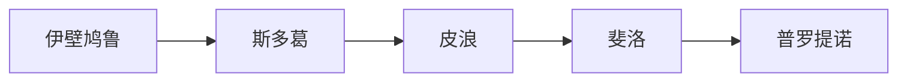
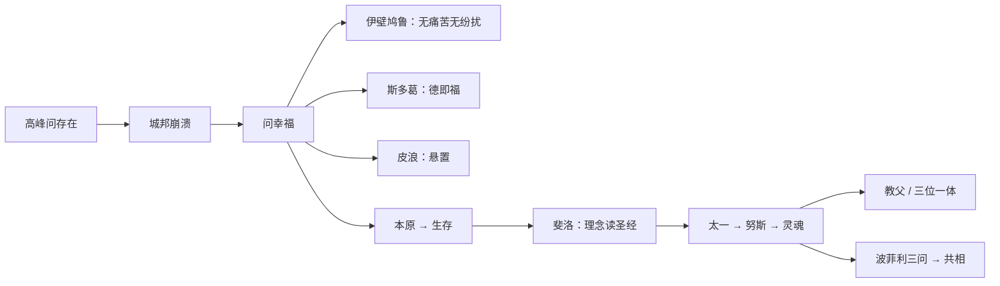

# 第六讲 希腊哲学的衰颓

> [!abstract] 一句话
> 城邦垮了，哲学从问本原变成问「不幸世界里如何幸福」。三派貌反神同，经新柏拉图把客观形而上学送进基督教。

上一篇：[[05 希腊实在论哲学]] · 下一篇：[[07 中世纪基督教哲学]]

## 1. 结构

书中两大节：希腊化时代的三大学派；罗马帝国时期的哲学过渡形态。

作者口味很硬：希腊化回流带来专制与纵欲，哲学蜕为伦理学。先当讲述立场，不必全盘接受。第一讲已提醒：他视放弃本质为低谷。

> [!warning] 两个芝诺
> 爱利亚的 [[芝诺]] ≠ 斯多葛创始人 [[季蒂昂的芝诺]]。

---

## 2. 希腊化时代的三大学派

亚历山大把希腊文化推到东方，东方的专制、享乐也回流。城邦制度瓦解，财富涌入。人不再问本原、实体，改问：在这个不幸的世界里如何幸福。黑格尔：三派貌似对立，共同点是对现实漠不关心——末世提问。

哲学由引导真理的火炬，变成跟在经验生活后面的救护车。主题：本原 → 生存意义。希腊问世界；基督教问被绝对化的人类精神。上帝与原子／理念都是背后者，但上帝管人的生存。

> [!note] 书外补
> 这里的「东方」指巴比伦、波斯、埃及，不是中国、印度。罗马人自己几乎没创哲学，共和国末期才从希腊拣伦理学。伊壁鸠鲁主义、斯多葛主义一直活到帝国。

### 2.1 [[伊壁鸠鲁]]

前 341—前 270。亚里士多德之后，求知本身不再是目的。怕神（自然异象）、怕死、与人不和——三样搅得灵魂不安。德谟克利特的原子世界铁一般必然，命运同样可怕。不靠外在本原崇拜，怎样去掉两个恐惧加一个人际麻烦，让身体无痛苦、灵魂无纷扰？

幸福用否定句写：不是「快乐是什么」，而是身体无痛苦 + 灵魂无纷扰。节制生活对身体；灵魂要对着三因下药。

异象不必是神怒——把神流放到世界缝隙。继承原子论：世界由原子构成。神可以有，但不干预。电闪雷鸣有自然原因。承认神又赶走神，作者叫他古希腊的无神论者。

德谟克利特：同质原子，只有形状、次序、位置；直线运动。他加重量（速度不同，一直影响到伽利略之前的成见）和**偏斜**。偏斜＝偶然＝暗示自由意志。马克思博士论文就做这个。他关心的首先不是自由理论，是：变化无常与神无关，不必怕。铁的必然松开了。

感觉最可靠——死时无感觉，故不足惧。德谟克利特贬感觉；他反过来：感觉是真理的见证，理性不能驳感觉。活着感觉不到死；死了消散为原子，没有感觉。未知才可怕；他把死后说成「无感」，从理论上拆恐惧。

人际用契约；不行就退出。继普罗泰戈拉之后再讲契约。大家守约则和；不守，至少独善其身。消极，但够用。

单有「追求快乐」，是后世纵欲标签——他的快乐是无痛苦、无纷扰。单有原子论，可以仍怕死、怕神。用原子论拆恐惧，幸福才落成否定句。

四药方：不怕神、不怕死、行善、忍恶。弟子越来越消沉；罗马晚期被说成醉生梦死，和斯多葛对打。作者：本人是审慎的节欲，主义被传成纵欲。见 [[伊壁鸠鲁]]。

> [!note] 书外补
> 本人尚节俭，不是后世「纵欲」标签。污名很大程度从西塞罗（斯多葛立场）传开；弟子是否有败家子，作者存疑。孟德斯鸠后来把希腊罗马的堕落算在「伊壁鸠鲁主义」头上——先把本人和主义分开。

### 2.2 [[季蒂昂的芝诺]]

约前 334—前 262。塞浦路斯人。和伊壁鸠鲁同一时代问题：纷扰世界里如何不动心。路径不能再是「快乐即幸福」——快乐太容易被听成放纵，也解释不了为何受苦仍要有德。若世界背后仍有理性／命运，服从它算不算自由？有德本身能不能就是幸福，而不靠快乐来定义？

赫拉克利特的火被说成有灵魂的世界大火，[[逻各斯]] 是世界理性。每人分有一点火花。四海之内皆兄弟——早期斯多葛反奴隶制、世界主义，亲马其顿。

若逻各斯就是命运，抗争只加痛苦。自由＝认识并服从必然（近代斯宾诺莎、黑格尔、马克思还在这条线上，语气积极得多）。道德生活＝顺应自然；[[美德即幸福]]，对打伊壁鸠鲁的快乐。

只有「服从命运」是宿命口号；只有「要有美德」苏格拉底已经说。世界理性 × 德即福、不靠快乐定义，才和花园派撕开。

西塞罗把斯多葛介绍进罗马。帝国越堕落，晚期越避世：此世是巴比伦，希望却还没有明说成天国——靠近基督教，差一层彼岸。

塞涅卡：「愿意的被命运领着走，不愿意的被拖着走。」爱比克泰德（释奴）：使人怕的不是灾难，是态度；人生如戏，场次角色已定。奥勒留：哲帝，五贤帝末位，文笔最美也最消沉——作者用来反证哲学王。哲学王的反例在第五讲已点过。见 [[季蒂昂的芝诺]]、[[美德即幸福]]。

> [!note] 书外补
> 前 294 年在雅典画廊下讲学，στοά＝斯多葛。早年读赫拉克利特的火与逻各斯，也读苏格拉底、犬儒、麦加拉。早期比晚期理智；晚期（塞涅卡、爱比克泰德、马可·奥勒留）更冷，作者拿来当「消沉」的例子。

### 2.3 [[皮浪]]

约前 360—前 270。智者已经示范：一切理论都有反说。伊壁鸠鲁、斯多葛仍在下判断（快乐／美德）。下判断就会和别人的判断打架，灵魂不得安宁。若对立两边都能说，还要不要判？不判能不能当一种生活？

[[悬置判断]]：任何理论都有反说，不下判才安宁。苦恼的根是太爱做判断。

晚期：十式攻感觉（动物器官不同、人与人不同、感官不同、身心状态、位置距离、混杂、对象自身变化、相对性质、罕见／常见、风俗法律）。五式攻理性（哲学家永争、根据无穷上溯、关系／测不准、公理对打、循环论证）。公理对打那条，作者用欧氏几何第五公设 vs 非欧来打比方——后话，用来懂「假定也能相反」。

和智者一样，极端处挖自己墙脚：断定「知识无效」也是判断；决定不做决定，仍是决定。

普罗泰戈拉也说两边都能说，却还可以主张一切皆真。「别下判」可以只是生活策略。悬置为了安宁，并把判断本身当成病，才是第六讲这种伦理化的怀疑。

比智者更落实到行为（至少传说如此）。怀疑主义锐利，无根，埋葬敌人时也殉葬——作者：昙花一现。休谟气质近，不是直接师承；习惯是人生指南，第四讲已预告。见 [[皮浪]]、[[悬置判断]]。

> [!note] 书外补
> 传说在海上指着一头安静吃食的猪：聪明人该这样。一种说法：他真的不躲危险，朋友跟着救；另一种：理论上悬置，生活谨小慎微，所以活到九十。作者让你自己选。晚期十式、五式是帝国时期怀疑派的系统化，不是皮浪本人写的。

---

## 3. 罗马帝国时期的哲学过渡形态

希腊哲学：客观精神，问世界本原。基督教：主观精神被绝对化成上帝。三派把哲学从天上拉到地上（智者、苏格拉底开过端，关键一推在希腊化）。真正对接理论的，是罗马帝国的新柏拉图。

### 3.1 [[斐洛]]

公元前后，亚历山大里亚的犹太人。一手《创世记》，一手柏拉图。不能丢信仰，也不能装没读过理念。

用 [[理念]]／[[逻各斯]] 读摩西——亚当＝理性，夏娃＝情感，蛇＝淫乱；上帝借逻各斯／理念造世界，感性是摹本。黑格尔：他在摩西身上看见柏拉图。恩格斯：基督教的真正父亲。「道成肉身」的哲学预备。

两希传统（希伯来＋希腊）在他这里自觉合流。圣经故事获得形而上学骨架，理念获得人格上帝。后面 [[普罗提诺]] 的 [[太一]] 更靠近三位一体结构。见 [[斐洛]]。

> [!note] 书外补
> 严格说他还是先驱，不是典型新柏拉图主义者。文化中心已从雅典移到亚历山大里亚，后来又成罗马世界的文化首都。

### 3.2 [[普罗提诺]]

约 204—270。罗素：古代伟大哲学家中最后一人。柏拉图的善本身仍可说「善」；阿派朗传统却说：终极根据必须说不清。基督教已在帝国长大，双方谁影响谁，作者说互相渗透。

多从哪来，又不让源头变成「又一个有规定的东西」？一、心灵、灵魂怎样既区分又不是三个神？

柏拉图已经够神秘；他把理念再神秘化。

[[太一]] 不可说。既不是有限也不是无限，既不是一也不是多，既不动也不静——两边都否定。一说就错，不如沉默。接阿那克西曼德「说不可说」，开否定神学。

努斯是具体化的太一。太阳与阳光：借光见日，不是两个实体。太一无法认识，努斯可认识。灵魂是呈现为多的太一。住在肉体里，经努斯窥见太一。柏拉图：灵魂带理念入身。

换名：太一／努斯／灵魂 ≈ 圣父／圣子／圣灵。奥古斯丁：改几字就是基督徒。结构同构，不是同一套教义。

只有「善本身」：柏拉图，还可谓述。只有流溢神话：宗教宇宙论。不可说的源头 × 流溢为一再分为多：才既保一、又解释多，并和三位一体对得上。

客观形而上学被送进基督教。学生波菲利注《范畴篇》，抛出 [[共相]] 三问，中世唯实／唯名由此开战。见 [[普罗提诺]]、[[太一]]。

### 3.3 波菲利：共相三问

约 234—约 305。哲学建树不多，提问极狠：共相是独立实体还是只在思想里？若是实体，有形还是无形？若无形，与可感物分离还是寓于其中？柏拉图倾向前者，亚里士多德倾向后者。他承认自己答不出。中世纪接过去打。

---

## 4. 逻辑链

高峰问存在 → 城邦崩溃 → 问幸福 → 三派伦理化 → 理念再神秘化 → 交给教父。

## 5. 术语与人物

**术语：** [[悬置判断]] · [[太一]] · [[共相]] · [[美德即幸福]]

**人物：** [[伊壁鸠鲁]] · [[皮浪]] · [[普罗提诺]] · [[斐洛]] · [[季蒂昂的芝诺]]

> [!tip] 这本书默认你会
> [[三位一体]] 才能懂「太一同构」；两个芝诺见 [[易混对照]]。教义补 [[预备概念与外读]] 第 3 节。

## 6. 复盘

- [ ] 能讲清：原子论和「要幸福」各自停在哪，两件怎么扣上才拆掉恐惧
- [ ] 能把三派的「幸福公式」各说一句，并指出貌反神同在哪里
- [ ] 能说明太一—努斯—灵魂和三位一体的同构（结构相似，不是同一套）
- [ ] 知道共相三问从哪冒出来

> [!question]- 参考（先自己答）
> 原子论用来证明神不干预、死无感觉、偏斜破铁的必然；幸福是否定句：无痛苦＋无纷扰。斯多葛：[[美德即幸福]]，服从世界理性。皮浪：[[悬置判断]] 得安宁。共同：对现实漠不关心，问如何在不幸中幸福。太一／努斯／灵魂 ≈ 父／子／灵的结构相似，不是同一套教义。共相三问：波菲利注《范畴篇》抛出，中世开战。
