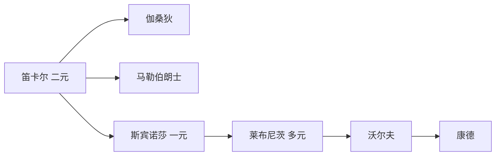
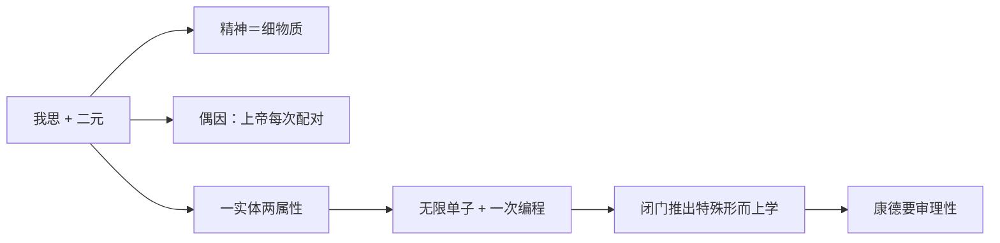

# 第九讲 欧洲大陆唯理论哲学

> [!abstract] 一句话
> 经验论尽头是怀疑论，唯理论用 [[天赋观念]] 保普遍必然。笛卡尔二元、斯宾诺莎一元、莱布尼茨多元，都在解身心如何既独立又协调；理性吹成独断论，把康德逼上场。

上一篇：[[08 近代哲学的转向与英国经验论]] · 下一篇：[[10 18世纪法国启蒙哲学]]

## 1. 结构

书中三大节：笛卡尔与唯理论开端；斯宾诺莎的泛神论；莱布尼茨的单子论。两派同一目标：既普遍必然、又能添新内容。经验论起点稳、升不到必然；唯理论必然好办，天赋观念凭什么、新内容从哪来？休谟把实体和必然规律都存疑之后，知识只剩一堆印象和观念，近代认识论的最高目标落空。大陆这边换一条路：不从感觉往上收，从与生俱来的清楚前提往下推。

正文跟书走。重要关节把推论写出来。人物卡写生平与后世纪，不在这里重复履历。

---

## 2. 笛卡尔哲学与唯理论的开端

培根从外感觉起；笛卡尔从内反省起。同用怀疑破经院，随后分道。大陆这边要的是数学那种必然：清楚明白的前提，往下推，步步保真。感觉给或然，给不了这种必然。所以必须有不来自感觉的观念——[[天赋观念]]。

身心问题是这一讲的暗线：思维与 [[广延]] 若是两类东西，我举手、臂为什么动？四条补丁见文末的表。

> [!note] 书外补
> **三十年战争（1618–1648）**：欧洲为教派与王朝打成一片。笛卡尔青年从军，在军营的炉边沉思里决定「只信自己能清楚明白看见的」。普遍怀疑不是书斋游戏，是一个士兵看着整个旧权威互相屠杀之后，问：还有什么不能骗我。
>
> 他后半生多在荷兰写作。荷兰相对宽容；法国的天主教权威和他的新物理学容易打架。《沉思集》的上帝，首先是方法上的担保人，不是堂区里的牧者。

### 2.1 [[笛卡尔]]

经院的大厦还在，地基却被新科学和宗教战争同时挖空。教会学校里的哲学、形而上学、逻辑、神学，他后来说除了数学都没有用。他要一座不再靠权威的知识建筑：先拆到不能再拆，再只在磐石上盖。怀疑是手段，不是目的——皮浪那种「为了安宁而不下判」，他不要。真理的标准他先定成：清楚明白；凡不够清楚明白的，都该怀疑。感觉只要骗过一次，就失去当第一块砖的资格。

桌上的假东西很多。感官会骗：塔远看小，近看有棱角；木棍在水里变弯。梦里也有「身体」：此刻分明坐在火炉边，猛醒却是梦，庄周梦蝶那一类分不清。幻肢会疼：战争里丢掉的腿，天阴时仍痛，身体本身可能是虚幻的。数学会不会是恶作剧上帝写的错剧本：一加一等于二清楚得很，可若有一个全能的骗子专门让我在最清楚处出错，数学也掉下去。这一步极狠：连「清楚」本身都可能是骗局。到这里，广延世界、身体、甚至几何，全部悬空。

骗本身骗不掉。无论是梦、是疯、是恶作剧上帝：只要「我在受骗」「我在怀疑」「我在想这些会不会假」，就有一件事正在发生——思想活动。你不能一边想「我没有思想」，一边完成这个思想。怀疑的内容可以全假，怀疑作为活动不能「没有发生」。站住的是活动，不是器官。「我有身体」依赖广延物存在；广延物刚被搁下。「我思」不依赖任何广延报告。它是内在的、当下的、进行式的。所以磐石是思维活动，不是肉体。

思想不能悬浮。有思，就要有承担者。他写成 [[我思故我在]]：从不可怀疑的思想活动推出思想者。这个推论坐在一个因果假定上：凡思想必有思想者。作者／康德：逻辑主语被偷换成实在精神实体——「我」作为语法需要，不等于一个灵魂实体已经被证明。休谟连这个实体「我」都拆成一串知觉。萨特：应说「思故（思）在」。笛卡尔本人把思与「我」当成一回事：思想一停，「我」也不在。古代怀疑论把怀疑当目的；他的怀疑是扫浮尘，为了找出磐石。

站稳之后，他还需要世界回来。单靠我思，只证明了一个在想的东西，外物、他人、自己的身体仍在括号里。于是再次借用安瑟尔谟的 [[本体论证明]]。我在怀疑，所以我不完满（怀疑相对于确定就是一种亏缺）。我之所以知道自己不完满，是因为心里有一个完满的尺度；在西方约定里，无限完满者就是上帝。完满者不可能只存在于心里而不同时具有客观存在——正如三角形的概念里已经含着内角和 180 度，圆的概念里已经含着半径相等。不完满者不能是完满观念的充足原因（结果不能大于原因），所以完满观念来自一个完满存在。上帝全知全能全善，不会骗人，于是清楚明白的观念可靠，于是有广延的世界可以回来。黑格尔式说法：上帝是理论大阴沟／跳板，过河拆桥——体系一立，日常科学里上帝可以隐退。

他对实体的界定：不依赖别的东西、别的东西却要依赖它。精神和物质彼此独立，在这个意义上都是实体；两者又都依赖上帝，所以只是相对实体，上帝才是绝对实体。精神的本质是思维，物质的本质是广延——[[古典二元论]]。精神无广延（不占空间），物质无思维。两类互不还原，互不决定，只靠上帝的大能保证协调。上帝把清楚明白的观念赋予我们，主要是几何公理、逻辑规则和上帝观念。以这些为出发点和规范，按演绎往下推，推出来的同样清楚明白。「清楚明白」于是变成真理的绝对标准。物理学上他却是机械唯物：承认物质世界客观、规律普遍必然，动物是机器，人体也按机械解释，和牛顿一起构成近代机械论的两端。

常识立刻追问：我决心举手，手臂为什么动？肉体受刺激，感觉传到心灵；心里有念头，肉体做出动作。他是科学家，不能假装没看见。晚年用松果腺讲 [[身心交感说]]：船在水里，水流经舵和传动轴反映到舵柄，舵手转舵柄又经同一套装置改变航向；松果腺就是那座舵台，灵魂住在里面，中枢神经把身体的遭遇传进来，也把心灵的决定传出去。与二元论打架——两个本质不同的东西，怎么在一粒腺里互相推？交感是经验性的相互影响；二元论要的是先验的各行其道。他没能解决，把问题留给后人：如何让物质和精神既彼此独立（不互为因果），又相互协调？

说法：方法怀疑；我思；上帝担保；天赋观念；古典二元；物理上却是机械唯物。洛克的靶子是天赋观念。身心裂缝逼出后面所有补丁。作者：上帝是方法论必需，不是结论里的主角。见 [[笛卡尔]]、[[我思故我在]]。

### 2.2 [[伽桑狄]]

笛卡尔把精神做成无广延的实体。伽桑狄站在复兴原子论的那一侧：世界上若只有一种材料，精神不过是更精细的物质。二元问题是被定义逼出来的，不是世界逼出来的。若思维也是某种极细的物质运动，则「两类实体如何作用」消失——不是被解决，是被取消。粗的物质管身体，细的物质管思想，都在广延里，机械因果一贯到底。

他对笛卡尔的几刀，作者认为有的很硬。普遍怀疑是装腔：健全的哲学家不会怀疑世界客观存在。「我」若全无广延，一个纯精神的东西凭什么独立实在？上帝证明的顺序被他拧过来：不是先有完满者才知道自己不完满，而是先发现自己不完满，再一步步完满化，推出上帝——上帝是「我」的结果，不是前提。松果腺更经不起问：它到底有没有广延？有广延，无广延的精神怎么住进去、怎么在里面与物质交感？无广延，它连「在哪里」都说不清，又怎么当场所？

作者评：粗暴。粗暴之处在于：他把「思想没有形状」这个笛卡尔最硬的现象，直接说成你看不清的形状。问题被喝掉，没有被消化。第九讲只作为身心问题的一种解法出现。对照：法国后来的 [[人是机器]] 比他更硬。见 [[伽桑狄]]。

### 2.3 [[马勒伯朗士]]

他是笛卡尔的虔诚学生，舍不得二元，也看见交感说在体系里不合法：两类本质不同的实体，没有共同媒介。松果腺是解剖学借口，不是形而上学答案。路向与伽桑狄相反：不把精神做成更细的物质，而把物质做成观念——柏拉图主义的近代复活。上帝创造了物质世界和精神世界，两者仍独立；我们并不直接认识物质，只在与上帝的精神交往中认识物质的观念。《圣经》里上帝按光的观念造光、按万物的观念造万物：观念是原型，事物是摹仿。山在外面，心里的「山」不是对那座山的直接交感，是从上帝那里获得的观念，比具体的山更真。精神世界与物质世界零接触，却仍有真实观念。物质被观念化了。

两座钟并排走，你以为左边带动右边。其实有三种讲法：齿轮咬合（交感）；有人每分钟对一次（他的路）；出厂时校准好，以后各自走（莱布尼茨）。他选第二种：身心并不互推，你的意愿是「偶因」，真正的原因每次都是上帝。[[偶因论]]，也可叫机缘论。我想抬臂的瞬间，上帝通过某种机缘让手臂抬起来；表面的心理原因只是偶然机缘，真正的原因是上帝同时拨动两边。上帝很忙。莱布尼茨嘲为救急神——解释不通就请神出手，神就成了临时工，也把上帝的智慧贬低了：随时调校的钟表匠是蹩脚工匠。把「协调」完全交给上帝的当下行动。莱布尼茨嫌他让上帝太忙，改成创世时一次写好总谱。斯宾诺莎则根本不承认有两个要配对的实体。见 [[马勒伯朗士]]。

---

## 3. 斯宾诺莎的泛神论

笛卡尔从「我」出发，再请上帝把世界担保回来——顺序反了。若上帝是绝对实体，就不该迟到，不该只当跳板。我思是经过一串怀疑才得到的，算不上当下直接呈现的清楚明白；从一个含糊的我思里推出上帝，他也不信。同时，二元留下的裂缝（两个相对实体如何交往）在他看来是假问题：先错误地切成两块，再问两块怎么缝。

阿姆斯特丹的犹太社群开除他；基督教会也不收。普鲁士高薪请他去海德堡，他怕不能自由发表而拒了；路易十四要以「献给法王」换年金，他也拒了。人格本身在回答：思想不卖。作者把他和苏格拉底并列。

出发点应是神，不是我思。我思是有限样式的一种活动；用有限给无限奠基，是头足倒置。经验论从被造事物出发，同样不是第一性。神是创造者，当下清楚明白，才是哲学真正的起点。可这个神是什么？他写明：[[神即自然]]。听「从神出发」像唯心，听到这一句才知作者为什么说他是唯物——自然不再是神的产品，自然就是那唯一的实在。泛神论在这里的意思：神内在于大自然，一草一木皆神性，神和自然是同一个东西。不是神住在草里当精灵。

他区分两个自然：作为原因的、自由的、创造自然的自然；作为结果的、受必然制约的、被自然所创造的自然。自然既是原因又是结果。三个范畴把这件事说清楚。实体：在自身内并通过自身被认识，形成它的概念无须借助于他物。按这个定义只能有一个——若有两个，彼此限制，就都不是「通过自身」。笛卡尔的精神和物质都要靠上帝来说明，不是真实体。神、自然、实体，三个词指同一件事。属性是实体的本质规定：实体有无限多属性，人只识两样，思维与广延。样式是实体的分殊，即具体事物。按两种属性，样式裂成两个系列：观念系列（心理活动）和事物系列（山川、身体）。笛卡尔的「两个实体」降格为「一个实体的两种属性」。

> [!example] 急性子的一体两面
> 同一个人，思想快，说话办事也快。不是思想「推动」了手脚，是同一个实体的两种表现先验地齐头。两条平行轨道上的列车并进，不是因为两车互相拉，是因为同一起点、同一速度。身心不再需要桥梁：你举手（广延一面）与你决意举手（思维一面）不是因果关系，是同一样式的两种读法。这就是 [[身心平行论]]。协调从经验交感升到先验的内在同一。作者承认有一点神秘，但比松果腺和救急神干净。莱布尼茨的前定和谐从这里接过「先验协调」这一截。

《伦理学》全名几乎就是宣言：用几何学方法作论证的伦理学。定义、公理、命题、绎理，层层推进。笛卡尔只是开端；把唯理论做成可演算体系的是他。观念也分三类。最高是直觉到的「真观念」：几何公理、逻辑规律、关于神或自然的观念，无须推理和感觉。其次是从真观念出发、按逻辑推出的证明观念。第三是感觉给的，他叫意见或想象——柏拉图把对感性世界的认识贬为意见，这个词在这里同样是贬义。感觉会骗：木棍入水变弯，塔远看圆弧、近看有棱。真观念本身既显示自身又显示虚假，像光明既照见自己也照见黑暗。内在标准是清楚明白并且恰当（从真观念恰当地推出新的真观念）；外在标准是真观念符合对象。这听起来像向经验论让步。作者说不是：按身心平行，真观念在事物系列里必有对应的真对象，符合是先验的一体两面，不是经验印证。关起门来从真观念演绎，仍然能建起整座大厦。

情感是混乱的观念；认识必然，情感就变成主动。[[神即自然|自由就是对必然性的认识]]：随心所欲不是自由，是无知。事物系列守自然必然，观念系列守逻辑必然，两边先验协调；你对必然看得越清，思想和行为越自由。作者点：经黑格尔影响唯物传统，今天教科书仍在用。

不要和 [[自然神论]] 捆：钟表匠立法后不管，神还在自然之外；斯宾诺莎的神没有「之外」。法国无神论把他的神再删一层（上帝住址：化进自然，然后清掉）。莱布尼茨嫌他抹掉个别、抹掉自由，要保住无限多的真个体。见 [[斯宾诺莎]]、[[神即自然]]。

---

## 4. 莱布尼茨的单子论

德国哲学的开端。思路和前面几位都不一样：深刻、神秘、比较晦涩。当时德语还没登大雅之堂，他从不用德语写作，只用拉丁语和法语；思想却已经是德意志的。两个迷宫：不可分的点与连续性；自由与必然（也可写成上帝的正义与世间的罪恶）。单子论对第一个；神正论（「最好世界」）对第二个，演讲只点到，细讲在他另一本《在上帝与牛顿之间》。

笛卡尔的广延物总可再分，找不到真「点」。斯宾诺莎的唯一实体又太整：个别事物只是波，人的自由像幻觉。洛克的白板他也不能要：若心里原无一物，必然真理从哪来？原子论早年吸引过他，后来看出问题：希腊语里原子本义是不可分，可原子作为物质有广延，有广延至少在理论上总可以一分为二。真不可分点不能是有广延的物质，只能是精神性的东西。他还要第三种钟：既不让钟互相带动（交感），也不让上帝每分钟来校（偶因）。

三种点。物理学的点（原子）实在，但有广延，可分。数学的点不占空间，不可分，却只是数轴上的符号，没有实在性。形而上学的点两边的优点都要：无广延故不可分，又是精神实体故实在。这个点就是 [[单子]]，他也叫「形式的原子」：只有形式、没有质料。保留了古代原子的实在、自动、数量无限，去掉广延；能动性来自内部的知觉和欲望。

单子的几个基本特点。没有部分，不能按自然方式组合或分解产生、消灭；产生只能是上帝一瞬间的闪耀（他拿后来的大爆炸作比方，只是多了一个上帝），上帝是创造一切单子的「太上单子」。没有窗户：自我封闭，不从外面接收印象，只靠内在的力推动自己，单子之间没有经验性交往。没有量的差别（无轻重大小），只有质的差别，表现为知觉能力不同。最低是微知觉：无生命物和植物的单子也能表象世界，只是很糟、很模糊——露珠以自己的方式折射一个世界，透过它看见的那个世界是糊的。动物有知觉。人的灵魂单子上升到能反省的 [[统觉]]，可以想感性背后的本质。再往上是天使和上帝，表象直接就是本质。表象不是反映：没有窗户，不能映照外面，是自己放出一个打上主体烙印的世界。客体的差异被还原为主体的差异。同一座城，蝙蝠、狗、人、上帝，不是四个城，是四种表象。世界什么样，取决于你什么眼光。

> [!example] 彩虹不是一座桥
> 无广延的单子如何「堆」出有广延的万物？无数个零相加仍是零——若按物理学堆积，问题无解。他把本体论问题收成认识论问题。彩虹远看像桥，近看是水滴在光里的效果，你上天抓不到一座「虹实体」。有广延的事物是单子堆积在我们这种中等知觉里呈现的现象。在太上单子上帝眼里，世界无非一大堆无广延的单子；在更低的单子眼里，也许只是一团浆糊。不是单子加出了广延，是不同眼光把同一堆积看成不同形态。

两条相反相成的规律。差异律：世界上没有两片完全相同的树叶——据说有贵夫人不服，派仆人去花园找，果然找不到完全一样的。任何两个单子在知觉能力上都有微妙差别；若完全相同，就不是两个。连续律：自然不作飞跃。A 与 B 之间再近，仍可插入更高的 C、再插入 D，无限密排。差异保住真正的多，连续保住世界不是一盘散沙。原子论有点无连续；笛卡尔物理学的充实空间有连续无点。单子论两头都要。作为数学家，他把微积分的气味带进了形而上学。

立刻出现新麻烦：每个单子受内在欲望驱向更高，彼此又不通窗户，中间还可以无限插值，整个世界岂不乱成一锅粥？像许多盲人挤在一间房里往前走。他用 [[前定和谐]] 收场。

笛卡尔难题到这里已经有三条旧路：经验交感（与二元打架）；偶因（上帝太忙，救急神）；还加上斯宾诺莎的一体两面。莱布尼茨谈三种钟：相互影响是流俗；偶因把上帝贬成蹩脚钟表匠；他自己选第三——出厂时一次校准，以后各自走，彼此独立却总对齐。电脑出厂预装程序：不是事后调，是事先写好。单子论把问题从两个实体放大到无限多实体，更需要总谱。每个单子只看分谱、各行其是，合奏却严丝合缝，因为作曲家事先写好了总谱。乐队的比喻：你以为第一小提琴在「带动」长笛，其实两人都在看同一份总谱的分谱。上帝创世时忙完，不必当救急神。这是一个最大的奇迹，取消了一切经验性的小奇迹；这个最大奇迹本身只能靠信仰：先信上帝万能，才接得住前定和谐。作者也点了一句社会启示：立法先把规范写好，比出了事再补（偶因）高明；前提是立法者得有上帝那种英明，事实并非如此。自由与必然那个迷宫：每个单子按自身欲望展开，总谱已含所有展开——表面像自由，秩序却先在。

洛克说心灵是白纸。笛卡尔说心里有现成的清楚观念。莱布尼茨折中：心灵是[[天赋观念|有纹路的大理石]]。纹路是先天的禀赋、倾向、习性，还不是现成观念；后天加工（经验刺激）让雕像顺着纹路出来。他承认经验有意义，决定性的仍是纹路。开篇就承认：洛克近亚里士多德，他自己近柏拉图——[[回忆说]] 那一路：经验只是媒介，把忘记的东西唤回来。笛卡尔只让少数观念天赋；他认为所有观念都作为潜能藏在心里。洛克的「反省」被他反将一军：你反省什么？心里若本无一物，反省对着虚空。认识过程是理性自身从微知觉到知觉再到统觉的提升：模糊变清晰，潜能变现实。理性够低，必须靠经验帮忙；理性够高，经验成为多余。海边听到的涛声其实是一颗颗水珠的迸溅，凡夫听成一片，上帝听成每一滴。对象之间在低理性那里充满偶然，在高理性那里全是必然。

两类真理把雅俗之别写死。[[推理的真理与事实的真理|推理的真理]] 从根本观念出发，靠同一律、排中律、尤其矛盾律往下推，排除经验，反面不可能，必然。[[推理的真理与事实的真理|事实的真理]] 靠感觉，依据他补上的充足理由律（若 A 真且从 A 推出 B，则 B 真），适合经验科学的综合命题，从偶然联系里找动力和原因，只是或然。一般人理性有限，必须靠事实真理。若有一位洞察一切的上帝，根本不存在事实真理，一切都可以按矛盾律闭门推出。两类的差别说到底是理性高低。表面向经验让步，这一步把经验的独立性收回去了。作者：仍是 [[独断论]]。

神正论：这个世界是可能世界中最好的——伏尔泰用里斯本地震嘲这一句。罗素：两个莱布尼茨——睿智哲人 vs 庸俗谄媚，神正论明显有为现实秩序涂脂抹粉的气味。与牛顿各自发明微积分，是书外名声；这一讲要的是他如何把身心问题收成一次编程。见 [[莱布尼茨]]、[[单子]]、[[前定和谐]]。

### 4.1 [[沃尔夫]]

莱布尼茨又深又散，学院需要可教的体系。他把单子论、神正论、理性心理学编成教材：从清楚的概念出发，按形式逻辑推出灵魂不灭、宇宙和谐、上帝存在。统治德国思想界约半个世纪，大学奉为经典。

若理性的形式已经够用，经验只是例证，不是法庭。于是可以闭门构造「特殊形而上学」各章。这一步把莱布尼茨表面留给事实真理的或然性也收掉了：教材里没有「也许」，只有「因此」。康德要审的 [[独断论]]，课堂上多半指这一套——不是莱布尼茨本人每一句，是被做成无须批判即可开推的理性。黑格尔后来嘲笑康德「认识之前先考察理性」像普罗旺斯海滩上那块牌子：「学会游泳之前切勿下水」。针对怀疑论和独断论，作者仍认为康德那一问有道理：两边都没问理性本身有多大能力、有没有界限。

演讲几乎不介绍人，只当反面教材。法国启蒙的理性法庭是唯物版独断；他是唯心／形式版独断。两边都没问：理性凭什么当法官？康德的第一问由此而来。见 [[沃尔夫]]。

---

## 5. 逻辑链

怀疑论贬理性，独断论夸理性，两边都没**理性地对待理性**。康德要先批判考察理性能力与界限。

| 方案 | 独立怎么保 | 协调怎么保 | 上帝有多忙 |
|------|------------|------------|------------|
| 松果腺交感 | 两实体 | 经验互作用 | 少管 |
| 偶因论 | 两实体 | 每次配对 | 很忙 |
| 身心平行 | 一实体两属性 | 先验一体两面 | 就是自然 |
| 前定和谐 | 无限单子 | 一次编程 | 创世时忙完 |

## 6. 术语与人物

**术语：** [[我思故我在]] · [[天赋观念]] · [[神即自然]] · [[单子]] · [[前定和谐]] · [[独断论]] · [[广延]] · [[古典二元论]] · [[身心交感说]] · [[偶因论]] · [[身心平行论]] · [[推理的真理与事实的真理]]

**人物：** [[笛卡尔]] · [[斯宾诺莎]] · [[莱布尼茨]] · [[伽桑狄]] · [[马勒伯朗士]] · [[沃尔夫]]

> [!tip] 这本书默认你会
> [[广延]]、身心问题、[[本体论证明]] 的近代翻版。四条补丁先看第 5 节的表，概念补 [[预备概念与外读]] 第 4 节。

## 7. 复盘

- [ ] 能说明：普遍怀疑之后为什么站住的是「我思」而不是「我有身体」
- [ ] 能说明笛卡尔的上帝为什么是跳板
- [ ] 能把交感／偶因／平行／前定和谐画成一张表
- [ ] 能说明「事实的真理」为何仍算独断论

> [!question]- 参考（先自己答）
> 身体依赖广延报告，广延可随梦、幻肢、骗子一起假；思想活动在「我被骗」这件事里无法取消。从「我不完满」推出完满上帝，再让上帝保证外物和观念——过河拆桥。交感：两实体经验互作用（松果腺）。偶因：上帝每次配对。平行：一实体两属性，先验齐头。前定和谐：开端一次校准。事实的真理表面或然，理性够高仍可闭门推出一切，故仍是 [[独断论]]。见 [[09 欧洲大陆唯理论哲学#2.1 笛卡尔]]、[[09 欧洲大陆唯理论哲学#4. 莱布尼茨的单子论]]。
