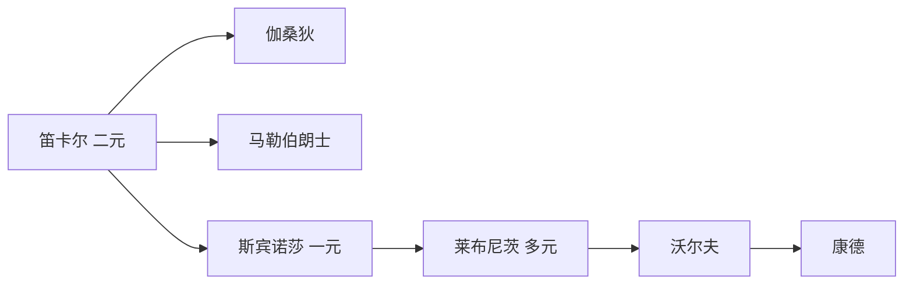
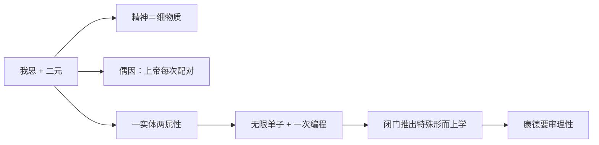

# 第九讲 欧洲大陆唯理论哲学

> [!abstract] 一句话
> 经验论尽头是怀疑论，唯理论用 [[天赋观念]] 保普遍必然。笛卡尔二元、斯宾诺莎一元、莱布尼茨多元，都在解身心如何既独立又协调；理性吹成独断论，把康德逼上场。

上一篇：[[08 近代哲学的转向与英国经验论]] · 下一篇：[[10 18世纪法国启蒙哲学]]

## 1. 结构

书中三大节：笛卡尔与唯理论开端；斯宾诺莎的泛神论；莱布尼茨的单子论。两派同一目标：既普遍必然、又能添新内容。经验论起点稳、升不到必然；唯理论必然好办，天赋观念凭什么、新内容从哪来？

正文跟书走。重要关节把推论写出来。人物卡写生平与后世纪，不在这里重复履历。

---

## 2. 笛卡尔哲学与唯理论的开端

培根从外感觉起；笛卡尔从内反省起。同用怀疑破经院，随后分道。大陆这边要的是数学那种必然：清楚明白的前提，往下推，步步保真。感觉给或然，给不了这种必然。所以必须有不来自感觉的观念——[[天赋观念]]。

身心问题是这一讲的暗线：思维与 [[广延]] 若是两类东西，我举手、臂为什么动？四条补丁见文末的表。

> [!note] 书外补
> **三十年战争（1618–1648）**：欧洲为教派与王朝打成一片。笛卡尔青年从军，在军营的炉边沉思里决定「只信自己能清楚明白看见的」。普遍怀疑不是书斋游戏，是一个士兵看着整个旧权威互相屠杀之后，问：还有什么不能骗我。
>
> 他后半生多在荷兰写作。荷兰相对宽容；法国的天主教权威和他的新物理学容易打架。《沉思集》的上帝，首先是方法上的担保人，不是堂区里的牧者。

### 2.1 [[笛卡尔]]

经院的大厦还在，地基却被新科学和宗教战争同时挖空。他要一座不再靠权威的知识建筑：先拆到不能再拆，再只在磐石上盖。怀疑是手段，不是目的——皮浪那种「为了安宁而不下判」，他不要。

桌上的假东西很多：感官会骗（塔远看小）、梦里也有「身体」、幻肢会疼、数学会不会是恶作剧上帝写的错剧本。若这些都能假，还剩什么？关键不是「他怀疑了一切，然后发现我思」，而是：**为什么普遍怀疑之后能站住的是「我思」，而不是「我有身体」。**

外物可以假。感官欺骗过我。凡欺骗过的，就没有资格当第一块砖。桌子、天空，先搁下。身体也可以假。梦里我有手脚，醒来没有那回事。疯子以为自己是南瓜。幻肢：没有手臂也能疼。所以「我有一个在空间里的身体」不是不可怀疑的——它和桌子同一级别，都靠感觉报告。数学也可以假。二加三等于五，清楚得很；可若有一个全能的骗子，专门让我在最清楚处出错，数学也掉下去。这一步极狠：连「清楚」本身都可能是骗局。到这里，广延世界、身体、甚至几何，全部悬空。

骗本身骗不掉。无论是梦、是疯、是恶作剧上帝：只要「我在受骗」「我在怀疑」「我在想这些会不会假」，就有一件事正在发生——思想活动。你不能一边想「我没有思想」，一边完成这个思想。怀疑的内容可以全假，怀疑作为活动不能「没有发生」。站住的是活动，不是器官。「我有身体」依赖广延物存在；广延物刚被搁下。「我思」不依赖任何广延报告。它是内在的、当下的、进行式的。所以磐石是思维活动，不是肉体。

思想不能悬浮。有思，就要有承担者。他写成 [[我思故我在]]：从不可怀疑的思想活动推出思想者。作者／康德：逻辑主语被偷换成实在精神实体——「我」作为语法需要，不等于一个灵魂实体已经被证明。休谟连这个实体「我」都拆成一串知觉。萨特：应说「思故（思）在」。笛卡尔本人把思与「我」当成一回事。

站稳之后，他还需要世界回来。单靠我思，只证明了一个在想的东西，外物、他人、自己的身体仍在括号里。我心里有一个完满的观念；我不完满（我会怀疑、会错）。不完满者不能是完满观念的充足原因——结果不能大于原因。所以完满观念来自一个完满存在：上帝。这是 [[本体论证明]] 的近代翻版。上帝不骗人，于是清楚明白的观念可靠，于是有广延的世界可以回来。黑格尔式说法：上帝是理论大阴沟／跳板，过河拆桥——体系一立，日常科学里上帝可以隐退。

精神本质是思维，物质本质是广延——[[古典二元论]]。两类实体互不还原：思维无形状，广延不思想。常识立刻追问：我决心举手，手臂为什么动？晚年用松果腺讲 [[身心交感说]]，与二元论打架——两个 essences 不同的东西，怎么在一粒腺里互相推？

说法：方法怀疑；我思；上帝担保；天赋观念（几何、逻辑、上帝）；古典二元；物理上却是机械唯物（动物是机器，人体也按机械解释）。洛克的靶子是天赋观念。身心裂缝逼出后面所有补丁：伽桑狄取消问题，马勒伯朗士请上帝随时配对，斯宾诺莎改成一个实体两种属性，莱布尼茨改成一次编程。作者：上帝是方法论必需，不是结论里的主角。见 [[笛卡尔]]、[[我思故我在]]。

### 2.2 [[伽桑狄]]

笛卡尔把精神做成无广延的实体。伽桑狄站在复兴原子论的那一侧：世界上若只有一种材料，精神不过是更精细的物质。二元问题是被定义逼出来的，不是世界逼出来的。

若思维也是某种极细的物质运动，则「两类实体如何作用」这个问题消失——不是被解决，是被取消。粗的物质管身体，细的物质管思想，都在广延里，机械因果一贯到底。作者评：粗暴。粗暴之处在于：他把「思想没有形状」这个笛卡尔最硬的现象，直接说成你看不清的形状。问题被喝掉，没有被消化。

第九讲只作为身心问题的一种解法出现。对照：法国后来的 [[人是机器]] 比他更硬。原子论传统的近代回声，本讲不展开。见 [[伽桑狄]]。

### 2.3 [[马勒伯朗士]]

他是笛卡尔的虔诚学生，舍不得二元，也看见交感说在体系里不合法：两类本质不同的实体，没有共同媒介。松果腺是解剖学借口，不是形而上学答案。

两座钟并排走，你以为左边带动右边。其实有三种讲法：齿轮咬合（交感）；有人每分钟对一次（他的路）；出厂时校准好，以后各自走（莱布尼茨）。他选第二种：身心并不互推，你的意愿是「偶因」，真正的原因每次都是上帝。[[偶因论]]。上帝很忙。莱布尼茨嘲为救急神——解释不通就请神出手，神就成了临时工。把「协调」完全交给上帝的当下行动。莱布尼茨嫌他让上帝太忙，改成创世时一次写好总谱。斯宾诺莎则根本不承认有两个要配对的实体。见 [[马勒伯朗士]]。

---

## 3. 斯宾诺莎的泛神论

笛卡尔从「我」出发，再请上帝把世界担保回来——顺序反了。若上帝是绝对实体，就不该迟到，不该只当跳板。同时，二元留下的裂缝（两个相对实体如何交往）在他看来是假问题：先错误地切成两块，再问两块怎么缝。

阿姆斯特丹的犹太社群开除他；基督教会也不收。他拒绝用教职和年金换安全。人格本身在回答：思想不卖。

出发点应是神，不是我思。我思是有限样式的一种活动；用有限给无限奠基，是头足倒置。实体的定义是：在自身内并通过自身被认识，不需要别的东西作为原因。按这个定义，实体只能有一个——若有两个，彼此限制，就都不是「通过自身」。

传统叫神；观察世界，你看见的是自然的整体。若神外在于自然，自然就另有根据，神就不是唯一实体。所以 [[神即自然]]：神内在，一草一木皆神性。听「从神出发」像唯心，听到这一句才知作者为什么说他是唯物——自然不再是神的产品，自然就是那唯一的实在。

实体有无限多属性，人只识两样：思维与广延。具体事物是样式，是实体的分殊。笛卡尔的「两个实体」降格为「一个实体的两种属性」。身心不再需要桥梁：同一件事的两面。观念系列与事物系列先验齐头——[[身心平行论]]。你举手（广延一面的事件）与你决意举手（思维一面的事件）不是因果关系，是同一样式的两种读法。

《伦理学》用几何学方法：定义、公理、命题。情感是混乱的观念；认识必然，情感就变成主动。[[神即自然|自由就是对必然性的认识]]：随心所欲不是自由，是无知。作者点：经黑格尔影响唯物传统，今天教科书仍在用。

不要和 [[自然神论]] 捆：钟表匠立法后不管，神还在自然之外；斯宾诺莎的神没有「之外」。法国无神论把他的神再删一层（上帝住址：化进自然，然后清掉）。莱布尼茨嫌他抹掉个别、抹掉自由，要保住无限多的真个体。作者：人格可与苏格拉底比——磨镜片、拒教职、拒年金。见 [[斯宾诺莎]]、[[神即自然]]。

---

## 4. 莱布尼茨的单子论

德国哲学的开端。两个迷宫：不可分的点 vs 连续；自由 vs 必然。笛卡尔的广延物总可再分，找不到真「点」。斯宾诺莎的唯一实体又太整：个别事物只是波，人的自由像幻觉。洛克的白板他也不能要：若心里原无一物，必然真理从哪来？

他还要第三种钟：既不让钟互相带动（交感），也不让上帝每分钟来校（偶因）。

原子若有广延，就可再切，不是不可分。不可分又要实在，就不能占空间。这种点不是物理微粒，是形而上学的点：[[单子]]。无广延、有知觉与欲望。没有窗户——不从外面接收印象，只按自身能力表象宇宙。广延事物是虹：远看有桥，近看是水滴的光学效果，不是另有一座「虹实体」。

微知觉（连自己都不清楚）→ 知觉 → [[统觉]]（能说「我」）。世界什么样，取决于单子什么眼光。同一座城，蝙蝠、狗、人、上帝，不是四个城，是四种表象。

两律一起要。差异律：没有两片相同的树叶——若完全相同，就不是两个单子。连续律：自然不作飞跃——等级密排，没有空洞。差异保证真正的多，连续保证世界不是一盘散沙。

单子没窗户，不能互推，却显然协调（身心、天体、音乐）。三种钟：交感／偶因／一次校准。他选第三：上帝创世时写好总谱，每个单子只看分谱，合奏却严丝合缝。[[前定和谐]]。上帝创世时忙完，不必当救急神。乐队的比喻：你以为第一小提琴在「带动」长笛，其实两人都在看事先写好的总谱。

心灵不是空纸，也不是现成印好的清楚观念，而是[[天赋观念|有纹路的大理石]]：纹路是潜能，经验是雕刻，雕像只能顺着纹路出来。必然真理（矛盾律）是纹路本身；事实真理（充足理由律）看起来或然——表面向经验让步。但理性够高（上帝那种），事实也可以闭门推出。这一步把经验的独立性收回去了。作者：仍是 [[独断论]]。

神正论：这个世界是可能世界中最好的——伏尔泰用里斯本地震嘲这一句。[[沃尔夫]] 做成教科书，闭门推出上帝、宇宙、灵魂。康德早年受这一系训练；「独断论的迷梦」被休谟打断，指的就是还没审理性就演绎出超验对象。罗素：两个莱布尼茨——睿智哲人 vs 庸俗谄媚。与牛顿各自发明微积分，是书外名声；这一讲要的是他如何把身心问题收成一次编程。见 [[莱布尼茨]]、[[单子]]、[[前定和谐]]。

### 4.1 [[沃尔夫]]

莱布尼茨又深又散，学院需要可教的体系。他把单子论、神正论、理性心理学编成教材：从清楚的概念出发，按形式逻辑推出灵魂不灭、宇宙和谐、上帝存在。

若理性的形式已经够用，经验只是例证，不是法庭。于是可以闭门构造「特殊形而上学」各章。这一步把莱布尼茨表面留给事实真理的或然性也收掉了：教材里没有「也许」，只有「因此」。康德要审的 [[独断论]]，课堂上多半指这一套——不是莱布尼茨本人每一句，是被做成无须批判即可开推的理性。

演讲几乎不介绍人，只当反面教材。法国启蒙的理性法庭是唯物版独断；他是唯心／形式版独断。两边都没问：理性凭什么当法官？康德的第一问由此而来。见 [[沃尔夫]]。

---

## 5. 逻辑链

怀疑论贬理性，独断论夸理性，两边都没**理性地对待理性**。康德要先批判考察理性能力与界限。

| 方案 | 独立怎么保 | 协调怎么保 | 上帝有多忙 |
|------|------------|------------|------------|
| 松果腺交感 | 两实体 | 经验互作用 | 少管 |
| 偶因论 | 两实体 | 每次配对 | 很忙 |
| 身心平行 | 一实体两属性 | 先验一体两面 | 就是自然 |
| 前定和谐 | 无限单子 | 一次编程 | 创世时忙完 |

## 6. 术语与人物

**术语：** [[我思故我在]] · [[天赋观念]] · [[神即自然]] · [[单子]] · [[前定和谐]] · [[独断论]] · [[广延]] · [[古典二元论]] · [[身心交感说]] · [[偶因论]] · [[身心平行论]] · [[推理的真理与事实的真理]]

**人物：** [[笛卡尔]] · [[斯宾诺莎]] · [[莱布尼茨]] · [[伽桑狄]] · [[马勒伯朗士]] · [[沃尔夫]]

> [!tip] 这本书默认你会
> [[广延]]、身心问题、[[本体论证明]] 的近代翻版。四条补丁先看第 5 节的表，概念补 [[预备概念与外读]] 第 4 节。

## 7. 复盘

- [ ] 能说明：普遍怀疑之后为什么站住的是「我思」而不是「我有身体」
- [ ] 能说明笛卡尔的上帝为什么是跳板
- [ ] 能把交感／偶因／平行／前定和谐画成一张表
- [ ] 能说明「事实的真理」为何仍算独断论

> [!question]- 参考（先自己答）
> 身体依赖广延报告，广延可随梦、幻肢、骗子一起假；思想活动在「我被骗」这件事里无法取消。从「我不完满」推出完满上帝，再让上帝保证外物和观念——过河拆桥。交感：两实体经验互作用（松果腺）。偶因：上帝每次配对。平行：一实体两属性，先验齐头。前定和谐：开端一次校准。事实的真理表面或然，理性够高仍可闭门推出一切，故仍是 [[独断论]]。见 [[09 欧洲大陆唯理论哲学#2.1 笛卡尔]]、[[09 欧洲大陆唯理论哲学#4. 莱布尼茨的单子论]]。
