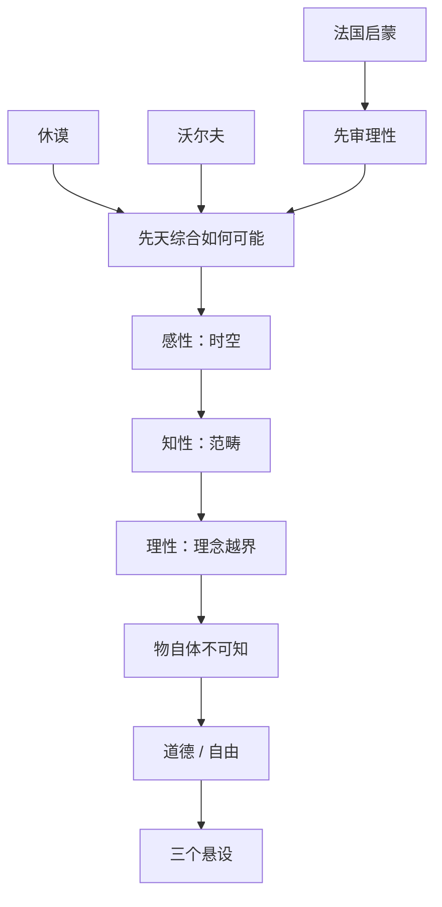

# 第十一讲 康德的批判哲学

> [!abstract] 一句话
> 休谟、沃尔夫、法国启蒙三块都没审过理性。他先审能力与界限，再用先天形式加经验质料救出科学；自由、上帝被赶到本体界。本想同时保住科学与信仰，结果把现象与 [[物自体]]、必然与自由划开。作者：真正伟大的是把问题摊开，不是收圆。

上一篇：[[10 18世纪法国启蒙哲学]] · 下一篇：[[12 从费希特到黑格尔]]

## 1. 结构

书中三大节：康德的知识论；康德的道德哲学；康德哲学小结。道德不是另起炉灶，是从知识论划下的界限里长出来的。三大批判对应知、意、情，总问题「人是什么」，最后答案「人是自由」——第一批判里还看不见自由。

正文跟书走。桌上三块并进知识论开头：三块观点相反，犯的是同一类错。

---

## 2. 康德的知识论

经验论推到底：实体、上帝不可知；因果是 [[习惯联想]]，普遍必然没了。知识变成一堆不知道从哪来的印象。他挖苦：还抵不上一场梦。他认半句：没有经验，知识开不了头。他不认另一半：形式也从经验里来。休谟把因果说成或然习惯；若科学还要「不可能别样」，形式必须另找来源。见第八讲、[[休谟]]。

大陆唯理论推到底，变成莱布尼茨—[[沃尔夫]] 教科书：从天赋原则按形式逻辑往下推，上帝、宇宙、灵魂都可以推出来。鸽子以为没有空气阻力会飞得更高——空气就是经验；没有经验，它飞不起来。他认半句：只有先天的东西才有普遍必然。他不认另一半：光有形式就是知识。同一律推不出黑天鹅。内容要经验给。见第九讲、[[独断论]]。

两边死胡同对着同一个目标：既要扩展内容，又要普遍必然。经验论保不了必然，唯理论保不了新内容。总问题已经在桌上：这种知识如何可能？

第十讲那一股：把一切拉到 [[理性法庭]]，物质世界不依人转移，「[[人是机器]]」，上帝被赶走。作者：这是唯物版独断——认识还没开始，客观世界及其规律已经被肯定了。理性审判一切，自己免审。[[卢梭]] 先拧向理性自身；康德接着审。缺了这一块，本讲只剩英美怀疑和德系独断，少掉「狂妄理性」这一面。后记把补课理由写死，见 [[13 修订版后记]]。

两派加启蒙，对理性的估价相反（一个贬、一个抬、一个神化），共同点是：没问理性能做什么、做到哪、越界会怎样。工作顺序倒过来：认识之前，先审能力、范围、界限。这叫批判哲学。黑格尔后来讥「下水前先学游泳」。作者：放回他的背景，这牌还是有道理的——前人栽就栽在没审。

他一上来就设定两个逻辑项，不是休谟那种「有没有实体我不说」。[[先验自我]] 提供形式，[[物自体]] 提供质料。不是笛卡尔那种实在心灵，也不是百科全书派那种现成物质。两边都是「不设定，现象说不清」。作者后来说：先验自我是更精致的独断，物自体是更精致的怀疑（必须有，又不可知）。费希特、唯物论后来各砍一边，正好说明这两设定本身没被证成。

> [!note] 书外补
> 1724—1804，几乎不出哥尼斯堡（今加里宁格勒），读破万卷。演讲很少讲政治年表。七年战争后普鲁士挤进大国，邦国仍碎，宫廷说法语，大学哲学多半是沃尔夫体系。英有牛顿和光荣革命，法有沙龙和即将到来的革命；德意志在实践上落后，在思想上要追。虔敬派管内心，科学理性是进口的普世话语。海涅后来说他在思想里处死了上帝，比作罗伯斯庇尔。年轻时的星云假说已在牛顿机械宇宙上切开「发展」——本讲重点仍是晚年批判。57 岁才出第一批判（1781）。把「先审理性」放回这里：既要科学必然，又放不下信仰传统，又瞧见英法理性的狂妄。

### 2.1 两条线索

明线：思维与存在（先验自我 vs 物自体）。他要在中间搭桥；结论却是自在之物不可知。同一性问题是他提出的；对立结论是他留下的。下一讲从这里开工。只读第一批判，只能看见这一条。

暗线：理性与信仰、科学与宗教。「悬置知识，为信仰留地盘」是暗线口号。知识论里上帝、灵魂没有立锥之地；谈完知识，转向实践理性，从必然转到自由，再从道德引出信仰。两边各管内外，井水不犯河水：既反对用理性去证上帝存在或不存在，也反对用信仰去压科学。

三大批判合起来问「人是什么」：能认识什么、应当做什么、可以希望什么。最后答案是「人是自由」。第一批判里还没有自由的位子——自然界只剩必然。自由是第二批判的根基。第三批判想把必然与自由、理论与实践接上，作者认为没接上。黑格尔：他留下的是一串没统一的矛盾。

### 2.2 先天综合如何可能

先把两根轴分开，再拼。别合成一套。

| | [[分析与综合\|分析]]（谓语已在主语里） | [[分析与综合\|综合]]（给主语加新内容） |
|--|----------------------------------------|----------------------------------------|
| [[先天与先验\|先天]] | 有必然，无新内容（三角形有三角） | **科学要的那一格** |
| 后天 | 少见 | 有新内容，无必然（这件衣服是绿的） |

唯理论死守左上：必然，同语反复。经验论死守右下：有新闻，推不广。科学两边都要：「先天」管必然，「综合」管扩展。这就是 [[先天综合判断]]。知识的最小单位是判断；不是任何判断都算科学知识。

「是否可能」：他认定数学、牛顿力学已经在——两点之间直线最短、作用与反作用。要问的是**如何可能**，不是它们在不在。总问题拆成四问：纯粹数学如何可能；纯粹自然科学如何可能；作为自然倾向的形而上学如何可能；作为科学的形而上学如何可能。

基本构架：先验自我给形式，自在之物给质料，二者合成既必然又有新内容的经验知识。下面三步把结合说完。

### 2.3 感性

先验自我提供时空：空间对外、时间对内，不是牛顿那种搬空东西还在的绝对容器。他从「能想空的空间，不能想没有空间的东西」反推：时空是直观的主观条件。自在之物给质料，掉进时空染缸就被染色，变成现象。测不准是后来的比方：手段一碰，对象不再是「未碰过的那个」。现象不是纯客观世界，是带主观烙印的对象——认识一边造对象，一边造关于对象的知识。几何对空间、代数对时间，数学作为先天综合在这一步成为可能。

### 2.4 知性

感性还被动：对象在面前，你不得不感觉。知性主动。十二[[范畴]]（量、质、关系、模态各三）加到已染色的现象上，才有因果、实体、作用反作用。休谟的因果被抬成「人同此心」的先天形式，不再是或然习惯。自然科学在这一步成为可能。

对象在认识里被构造：不是观念符合对象，是对象符合观念。[[人给自然立法]]。自然律是理性在理论方面颁布的；稍后道德律是实践方面颁布的。范畴只能用在现象上，不能用在超验的自在之物上。知识到此都是关于现象的知识。

### 2.5 理性（狭义）

感性、知性之后，狭义理性还要用灵魂、宇宙、上帝三个理念做更高综合。它们本该只起调节作用：把心理学知识往「灵魂」收，把物理学知识往「宇宙」收，再往「上帝」收。理性天生越界，把理念当成实体，再把范畴非法套上去——用磅秤量身高。笛卡尔把逻辑上的「我」偷换成实在灵魂，是这一类错。

四个 [[二律背反]]：有限／无限，单纯／复合，自由／自然因果，绝对必然者有／无。正题偏唯心，反题偏唯物，两边都能自圆。问题不在答案，在**问错了对象**。「有限」只能用于现象，不能用于整体宇宙。

作为自然倾向的形而上学，就这样成为可能——它是理性越界的自然病。救法：理论理性只做内在运用（调节知识），不做建构超验对象。作为科学的形而上学，他交给实践理性，即道德形而上学。知识论到此让出地盘。

### 2.6 物自体必须假定又不可知

两句要一起说，缺一句就滑走。

没有它，质料没来源，认识是无源之水。休谟两边都不说，费希特后来问：一无所知凭什么说它在？康德留它，一半因为常识和法国唯物那块「客观世界」，一半因为形式自己变不出内容。

范畴只能用在现象上。它一成为对象，就已被时空染色，不再是它自己。现象不是桥，是鸿沟。黑格尔：理性的怯弱——认识本该透过现象抓本质，他却把现象做成最后界限。

谢林会接着说：不可知的正好交给信仰。下一讲从同一性问题开工。见 [[康德]]、[[物自体]]、[[人给自然立法]]。

---

## 3. 康德的道德哲学

现象界只剩自然律。自由、上帝、灵魂在知识里没有立锥之地——不是被消灭了，是被赶到本体界。理论理性说「实际如此」；实践理性说「应该如此」。知识量与道德质无关：近 [[卢梭]]，远「[[美德即知识]]」。

### 3.1 道德律与自由

[[绝对命令]]：去掉「否则受罚」的条件句。合法 ≠ 道德。形式：「要使你的准则同时能成为普遍立法原则。」他不列具体该不该杀、该不该偷，只问这条准则能不能推广。三个层次要一起记：像自然律一样普遍；始终把人——自己和他人——当作目的，而不仅仅当作手段；自己立法、自己遵守。道德律是自由的认识理由，自由是道德律的存在理由。

三种自由：随心所欲推不广；认识并顺应外在必然仍是 [[自律与他律|他律]]（斯宾诺莎那条）；他要的是自律的自由。决定道德的是动机，不是效果：客观上合律、主观上却出于功利，只叫合法。近卢梭的动机论，远爱尔维修、边沁的功利论。

### 3.2 从道德引出信仰

德性是最高善，还不是至善。至善要德福统一。人精神上可守道德律，肉体仍受自然律——实践理性自己的二律背反：从幸福推出道德（伊壁鸠鲁／功利），还是从道德推出幸福（斯多葛）。他判两边都把德福当成分析关系；德福至多是综合的，而且只能道德为因、幸福为果。现实常是有德者不幸——信心会垮。

三个 [[悬设]]：意志自由（才能成德）、灵魂不死（一生做不完）、上帝存在（给自由世界的德配上自然世界的福）。**实践需要，不是理论证明。** 从道德出宗教，不是从宗教出道德。上帝从外在自然迁到内在道德。这是暗线的收口：科学与信仰划界并行，不是真正和解。见 [[绝对命令]]、[[悬设]]。

---

## 4. 康德哲学小结

一边想超怀疑论，结论仍是物自体不可知；一边想超独断论，起点却独断了先验自我与超验物自体。作者：**他陷入了更精致的怀疑论和独断论**。提出问题比解决问题更重要。现代各派爱「回到康德」，少有人「回到黑格尔」——黑格尔把话说满了，后面不好接。

三道裂缝。思维／存在：现象是鸿沟，不是桥——费希特砍物自体；黑格尔怪理性怯弱。理论／实践：知识量与道德质无关——第三批判想补，作者认为没补上。理性／信仰：各管内外，井水不犯河水——划界影响巨大，却不是和解。

矛盾问题上：发现理性阶段必然出矛盾，打开近代辩证法；却仍把矛盾当「理性的谬误」，只有正反，没有合。黑格尔：他太温情，不让矛盾染世界。

> [!note] 书外补
> 本讲几乎不讲第三批判。外读先《未来形而上学导论》，再碰第一批判。邓晓芒、赵林合著专业本康德章可对照。海涅《论德国宗教和哲学的历史》里的罗伯斯庇尔比喻是课堂常用的书外掌故，不是论证本身。

---

## 5. 逻辑链

休谟塌必然 ＋ 沃尔夫闭门推 ＋ 法国启蒙不自审 ＋ 德意志要同时保住科学与信仰 → 先批判理性 → 形式＋质料＝现象知识 → 人给自然立法 → 越界则二律背反 → 物自体必须有又不可知 → 知识让出地盘 → 绝对命令＝自由 → 德福撕裂 → 悬设上帝 → 裂缝留给下一讲。

## 6. 术语与人物

**术语：** [[先天综合判断]] · [[先天与先验]] · [[分析与综合]] · [[物自体]] · [[范畴]] · [[先验自我]] · [[人给自然立法]] · [[二律背反]] · [[绝对命令]] · [[自律与他律]] · [[悬设]]

**人物：** [[康德]] · [[休谟]] · [[卢梭]] · [[沃尔夫]]

> [!tip] 这本书默认你会
> 这一讲默认最多：先天／先验／超验、分析／综合、十二范畴、理论／实践理性、自律／他律、悬设。先读 [[预备概念与外读]] 第 5 节，再读正文。外读入口：《未来形而上学导论》。

## 7. 复盘

- [ ] 能说出休谟与康德的因果差在哪；取消物自体后质料从哪来
- [ ] 能说明「人给自然立法」如何把自由从自然界赶走、实践理性如何接回
- [ ] 能指出那两个未经论证的设定分别对应怀疑／独断哪一端
- [ ] 能用三道裂缝各说一句：思维／存在、理论／实践、理性／信仰

> [!question]- 参考（先自己答）
> 休谟：因果是习惯，或然。康德：因果是先天范畴，普遍必然，但只用于现象。取消物自体，现象的质料没来源——所以必须假定它，又永远不可知。自然界被范畴立法，只剩必然；自由赶到本体／实践理性，[[绝对命令]] 接回。两个未经论证：超验物自体（对着更精致的怀疑）＋先验自我（对着更精致的独断）。三道裂缝：现象是鸿沟不是桥；知识量与道德质无关；科学与信仰划界并行。见 [[11 康德的批判哲学#2. 康德的知识论]]、[[11 康德的批判哲学#4. 康德哲学小结]]。
