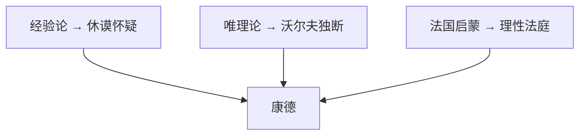

# 修订版后记

> [!abstract] 一句话
> 初版因课时砍掉法国启蒙，作者视为必须补上的逻辑缺口：它与经验论、唯理论并列，构成康德的第三块背景。缺了它，「先审理性」少掉最狂妄的那一面。

上一篇：[[12 从费希特到黑格尔]]

这一讲不是人物列传，是作者交代为什么必须补第十讲。

## 1. 初版少了一整讲

按 [[历史与逻辑相统一]] 讲，少掉书袋。初版出自武大、东南大学通识课录音。当时课时不够，整讲删掉 18 世纪法国启蒙，出版后一直成心病。理想国邀修订，才补上 [[10 18世纪法国启蒙哲学]]。

不是添彩页。缺的是康德桌上的第三块，不是一章文化风景。作者说：无论从思想演化的逻辑线索，还是从学派兴替的历史脉络看，这一部分都非常必要。法国启蒙更多是文化学意义，不是狭义哲学；转承作用仍不容忽略。

## 2. 法国启蒙为什么不是彩页

推论要走完，不能停在「思想史也该有它」。

它是近代原则的历史结果。经验原则和理性精神在英法各走到极端之后，法国把它做成社会行动：理性法庭、公开无神、唯物独断。逻辑上它接在第八、九讲后面，不是旁支。

康德要审的理性有两副面孔。沃尔夫是闭门推上帝的那一副（形式万能、不要经验）。百科全书派是另一副：肯定一个不依人的物质世界，再用它审判宗教、政治、人本身。只讲休谟＋沃尔夫，康德像只在调解英美怀疑和德系教科书；补上法国，才看见他还在审「理性当新上帝」。

第十一讲的综合少一条腿。「先天综合如何可能」对着经验论／唯理论；「先审理性」对着所有未经批判的理性。法国启蒙是后一句的主要对手之一。[[卢梭]] 先拧向理性自身，康德接着做系统审查——这条线没有第十讲，会变成突然出现。

文化学意义大于狭义哲学，仍必须讲。作者自己降调：法国哲学像文学。转承作用仍在：没有这股破坏性实践（大革命），后面德意志「思想里的行动」也少一个对照。费希特＝拿破仑这个比方，前提是法国已经在政治里革过命。

缺页的后果：上帝四次搬家少「从自然里清掉」那一站；唯物独断、[[教育万能]]、[[人是机器]] 这些对手从康德章蒸发；后记那张三面图塌成两面。

## 3. 此刻为什么还要读

作者自认「生在红旗下，长在红旗下」，经历过两个大时代：突出政治的时代，和发展经济的时代。两个时代里，人都像着魔一样卷入外在的政治表现和利益角逐，人生意义好像就在政治理想或经济目标里。中间只有一小段文化复兴（1978–1989）：那时候年轻人见面谈文学和哲学，不是政治和经济。插曲转瞬即逝，全国又投入发财致富。

发展亢奋时，哲学是累赘的文化奢侈品。内卷、躺平之后，身体躺平、灵魂躁动，物质喧嚣平息，精神反思悄然萌动。哲学可能变成寄托无奈和无聊的慰藉。一个哲学的时代，似乎正跟着一个经济的时代静悄悄来临。

立刻警告：全民「活学活用」哲学比哲学冷寂更危险。那种疯狂甚至比冷寂更有害。只有越来越多的人从片面追求外在成功转向内在反思，「热爱智慧」才是理性启蒙的前提。内外兼修、精神与物质并驾齐驱的新纪元，才谈得上真正来临。他山之石，用来更深地认识世界与自己——接到第一讲的 [[改变自身]]。

这和康德「先批判再运用」是同一类谨慎：都怕未审的理性去改造一切。第十讲的理性法庭，正是这种未审的范本。

## 4. 康德的三面背景

休谟刺激他：形式必须先天，因果不能只是习惯。沃尔夫刺激他：内容必须经验，超验对象不能闭门推。法国启蒙刺激他：理性自身必须先上法庭。

## 5. 术语

[[历史与逻辑相统一]] · [[理性法庭]] · [[沃尔夫]] · [[10 18世纪法国启蒙哲学]]

## 6. 复盘

- [ ] 能各举一例说明三面分别刺激了康德哪一步
- [ ] 若只把法国启蒙当文化思潮，康德要审的「理性狂妄」会少掉哪些对手
- [ ] 作者既欢迎转向哲学、又怕「活学活用」，和康德「先批判再运用」是不是同一类谨慎

> [!question]- 参考（先自己答）
> 经验论：休谟把因果说成习惯 → 形式必须先天。唯理论：沃尔夫闭门推上帝 → 内容必须经验、先审理性。法国启蒙：理性法庭不自审 → 批判理性自身。少掉百科全书派，就少掉唯物独断、无神论、教育万能这些对手，第十一讲只剩英美怀疑和德系独断。欢迎反思、怕狂热套用，和「先批判再运用」同类：都怕未审的理性去改造一切。
