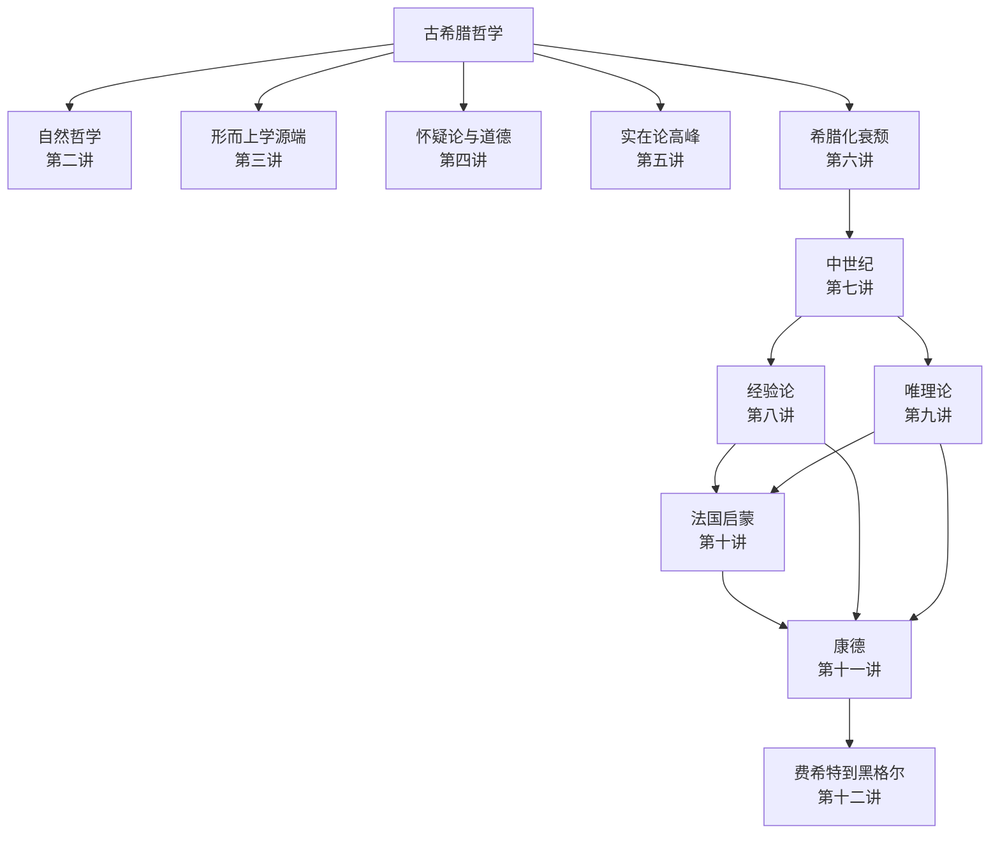

# 西方哲学史讲演录

通识课讲稿。从希腊讲到 [[黑格尔]]，不讲现代哲学。修订版补上法国启蒙，见 [[13 修订版后记]]。

> [!abstract] 先记住三句
> 1. [[哲学]] 首先是智慧，不是教条。
> 2. 学哲学必须学哲学史。见 [[哲学史就是哲学]]。
> 3. 哲学没有功利之用，却有 [[改变自身]] 的大用。

## 1. 怎么用这套笔记

- 章节笔记讲「这一讲说了什么」；每人先有一段故事（他为什么会想到），再讲理论。人物／术语卡比讲稿全，但不重复那段故事。读法见 [[如何使用这套笔记]]。
- 术语卡、人物卡是原子笔记，可在图谱里点来点去。
- **白板**（Excalidraw）看师承／对打／合题：[[人物关系.excalidraw]] · [[知识图谱.excalidraw]] · [[全书线索.excalidraw]]；旧 Canvas 留着对照。
- 容易拧的对照：[[易混对照]]。各章自测总入口：[[复盘]]。
- 演讲默认你会、书里没展开的词：[[预备概念与外读]]。
- 自动 **图谱**（`Ctrl+G`）看谁链过谁；说明见 [[怎么用]]。
- 索引用 Bases 自动汇总，不用手改目录。

更细的约定见 [[如何使用这套笔记]]。

## 2. 进度

- [x] [[00 自序]]
- [x] [[01 哲学是什么与哲学有什么用]]
- [x] [[02 希腊自然哲学]]
- [x] [[03 希腊形而上学的源端]]
- [x] [[04 希腊怀疑论与道德哲学]]
- [x] [[05 希腊实在论哲学]]
- [x] [[06 希腊哲学的衰颓]]
- [x] [[07 中世纪基督教哲学]]
- [x] [[08 近代哲学的转向与英国经验论]]
- [x] [[09 欧洲大陆唯理论哲学]]
- [x] [[10 18世纪法国启蒙哲学]]
- [x] [[11 康德的批判哲学]]
- [x] [[12 从费希特到黑格尔]]
- [x] [[13 修订版后记]]

## 3. 白板

| 白板 | 看什么 |
|------|--------|
| [[人物关系]] | 从泰勒斯到马克思：师承、对打、叫醒 |
| [[知识图谱]] | 本原、理念、物自体、绝对精神这条概念线 |
| [[全书线索]] | 十二讲怎么接上康德 |

用法：[[怎么用]]

## 4. 章节

![[章节.base]]

## 5. 术语

![[术语.base]]

## 6. 人物

![[人物.base]]

## 7. 全书线索

作者把希腊哲学先拆成五块，后面各讲对号入座：

两条追问 [[本原]] 的路，从第二讲开始分叉：

| 路径 | 问法 | 关键词 |
|------|------|--------|
| [[自然哲学]] | 从什么产生？由什么构成？ | [[质料因]]、还原、[[原子]] |
| [[形而上学]] | 何以如此？根据是什么？ | 形式、本质、[[逻各斯]]、[[存在]]、[[理念]] |

近代重问的是思维与存在能否同一：

| 路 | 尽头 | 康德怎么接 |
|----|------|------------|
| 经验论 | [[休谟]] 怀疑 | 形式必须先天 |
| 唯理论 | 沃尔夫 [[独断论]] | 内容必须经验 |
| 法国启蒙 | [[理性法庭]] 未自审 | 先批判理性 |

德国古典是裂缝的接力修补，不是「越来越正确」：[[康德]] 划界 → [[费希特]] 取消物自体 → [[谢林]] 绝对同一 → [[黑格尔]] 过程中的同一 → [[马克思]] 头足倒置。
